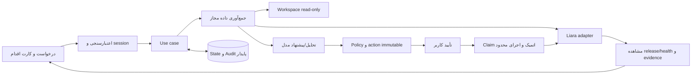

# معماری Launchlane

## برش اجرایی Agent؛ A01/A02/A03/A06

`server/agent/runs.ts` حلقه هدف جدید را از diagnosis تاریخی جدا نگه می‌دارد. `toolsForAgent` یک registry نوع‌دار برای inspect/file/destination/status/releases/logs و پیشنهاد اصلاح gated است؛ همه اجراها application و policy فعلی را مصرف می‌کنند. نتیجه واقعی ابزار با call ID به پیام بعدی مدل متصل است. GET، reload و event replay هیچ مدل یا write را اجرا نمی‌کنند؛ POST معتبر، کار محدود را با `after` آغاز می‌کند. پایان این برش فقط نیاز به ورودی یا نتیجه جزئی است؛ متن مدل رسید انتشار تولید نمی‌کند.

migration شماره 8، `agent_runs` و `code_repair_jobs` را به SQLite موجود اضافه می‌کند. CAS revision، actor، idempotency، snapshot پروژه/نسخه/مقصد، event و شمارنده بودجه پیش از request ذخیره می‌شوند. پیام بعدی و worker، همان سقف تجمعی مدل/tool/time را مصرف می‌کنند؛ زمان انتظار تصمیم کاربر از اجرای فعال جداست. مصرف نامشخص صفر فرض نمی‌شود. بازیابی اجرای قطع‌شده، interrupted است و request هزینه‌دار را replay نمی‌کند. مسیر تک‌ابزاری diagnosis و قرارداد قدیمی دو درخواست آن تغییر نکرده‌اند.

`CodeRepairAdapter` دارای propose/start/status/cancel/run و رسید diff/test/artifact است. پیشنهاد فقط snapshot جدا می‌سازد؛ اجرای آزمون/وصله به تصمیم معتبر actor/session/revision/expiry روی همان محدوده نیاز دارد. worker یک درخواست patch با provider مجاز دارد؛ host مستقلاً base/path/command/tests را کنترل می‌کند. فعلاً فقط فایل‌های موجود و آزمون مستقیم `node --test`، بدون تغییر package/dependency/test پشتیبانی می‌شوند. آزمون اصلی باید خطا را بازتولید کند؛ همان آزمون پس از patch باید بگذرد و snapshot پس از آزمون تغییر نکرده باشد. آرشیو خصوصی immutable، دقیقاً به نسخه انتخاب‌شده `repair` متصل می‌شود؛ source اصلی جایگزین نمی‌شود. سپس مسیر انتشار موجود می‌تواند برای همان artifact تصمیم جدا بگیرد؛ انتشار از حلقه گفت‌وگو هنوز ابزار نیست.

فرآیند آزمون با `process.execPath`، بدون shell، environment محدود، Node permission برای همان workspace، timeout/output cap و بدون اجازه child/worker/addon اجرا می‌شود. این روش OS sandbox یا جداسازی شبکه نیست؛ gate `LAUNCHLANE_ENABLE_LOCAL_REPAIR` پیش‌فرض false است و روی source ناشناس تضمین مهار خصمانه نمی‌دهد. build/package-manager/نصب dependency/تست تولیدی worker، runtimeهای دیگر و sandbox سیستم‌عامل هنوز پیاده نیستند. spike CLI و مرز واقعی در [گزارش اجرایی](docs/evidence/agent-first-slice.md) آمده‌اند.

## جهت معماری Agent؛ planned

تصمیم محصول جدید در [مشخصات Agent](docs/agent-experience.md) تعریف شده است: وب‌اپ با Agent هدف‌محور، اتصال اجرایی Coding Agent و facade نوع MCP روی ابزارهای مشترک. مسیر تشخیص تک‌ابزاری و executor محدود فعلی پایه‌اند؛ دامنه دائمی محصول نیستند. جدول زیر مقصد معماری است؛ برش پیاده‌شده بالا و قابلیت‌های باز در TASKS مرجع وضعیت جاری‌اند.

ساختار پیشنهادی بر همان Next.js/TypeScript/SQLite:

| بخش | مسئولیت | اتصال به پایه فعلی |
| --- | --- | --- |
| رابط مکالمه و کارت‌ها | context، ورودی هدف، سؤال، تصمیم، progress و نتیجه | componentها، حساب‌ها، project flow و گزارش موجود |
| AgentRun و orchestrator | plan و انتخاب tool، ادامه از نتیجه، بودجه و completion هدف | توسعه server/agent و budget؛ diagnosis قدیمی سازگار بماند |
| registry مشترک ابزار | schema، read/write/local-work classification، execute و نتیجه typed | wrapper روی applicationها؛ policy داخل ابزار قابل دورزدن نباشد |
| application و policy | provision، env، deploy، restart، observe و approval | reuse deployment/restart/execute/Store؛ use case تازه فقط برای شکاف |
| CodeRepair adapter | job اجرایی، workspace، patch/test receipt و artifact | اتصال runtime واقعی یا worker scoped؛ handoff دانلودی حفظ شود |
| persistence و events | run/message/step/job/event، CAS و recovery | migration جدید append-only؛ تاریخچه و action journal موجود مرجع بماند |
| MCP facade | همان registry و scope/approval از میزبان خارجی | transport جدید؛ نه موتور و اجازه مستقل |

APIهای برش جاری در جدول زیر پیاده‌اند؛ مسیر مستقل SSE یا plan/provision API هنوز نداریم:

| مسیر جاری | قرارداد |
| --- | --- |
| POST /api/agent/runs | ایجاد مأموریت با goal، project reference و request idempotency key |
| GET /api/agent/runs | آخرین run همان actor؛ بدون اجرای مدل یا ابزار |
| GET /api/agent/runs/{id} | بازیابی state/events/repair همان actor؛ بدون مصرف مدل یا اجرای مجدد |
| GET /api/agent/runs/{id}?after=N | state کامل و eventهای بعد از cursor برای replay؛ polling، بدون progress نمایشی |
| POST /api/agent/runs/{id}؛ operation=message | پاسخ با revision/requestKey/message؛ client نقش system/tool تعیین نمی‌کند |
| POST /api/agent/runs/{id}؛ operation=repair-decision | تصمیم approve/reject با revision و jobId روی scope پایدار؛ این تصمیم انتشار نیست |
| POST /api/agent/runs/{id}؛ operation=cancel | توقف محلی/انتظار و ثبت آثار احتمالی؛ نه ادعای undo upstream |

CodeRepairJob محدودِ پیاده‌شده، و plan approval و WorkloadContract آینده در سند مرکزی تعریف شده‌اند. برای ساخت app تازه، selectors تأییدشده و ID برگشتی باید در journal به مراحل بعد متصل شوند؛ allowlist صرف نام، مجوز برنامه تازه هم‌نام نیست. برای نتیجه عمومی HTML/API، spec جدید افزوده شود؛ انتظار JSON/revision و canonicalizationهای v1 تا v6 تاریخی بازنویسی نشوند.

رویدادهای UI و context مدل از یک منبع پایدار می‌آیند ولی داده یکسان ندارند: UI خلاصه قابل فهم، مدل context حداقلی sanitized و audit receipt فنی دریافت می‌کند. server سیاست و هزینه/مجوز را کنترل می‌کند. budget مأموریت جدید از سقف feature قدیمی تشخیص جداست و مجموع مدل، retry، tool، worker و انتظار را حساب می‌کند.

مرز اجرای source نیز روشن است: inspect بدون اجرای script؛ build/test فقط در repair workspace مجاز با فرمان معتبر و environment کنترل‌شده. روش isolation پس از spike مستند شود و ادعای sandbox بیش از امکانات واقعی نداشته باشد. تغییر local source و write زیرساخت، مجوزهای اثر متفاوت دارند.

## وضعیت موجود و سوابق

این سند ترکیبی از **وضعیت موجود** و **تصمیم پیشنهادی برای پیاده‌سازی** است. بخش‌های planned هنوز capability محصول نیستند. قرارداد API در `docs/api-capabilities.md` و OpenAPI مرجع در `docs/sources/` هستند؛ پذیرش محصول در `docs/acceptance.md` است.

سنجش زنده محدود در ۲۰۲۶-۱۰-۲۲ شامل سه release، خطای واقعی 500، یک تشخیص با مدل و اصلاح source با approval بود. [trace پاک‌سازی‌شده](docs/evidence/controlled-live-cycle.md) مرز آن را از آزمون‌های مصنوعی جدا می‌کند. ساخت app/network در harness خصوصی اپراتور انجام شد و قابلیت محصول نیست.

## انتشار محدود؛ قرارداد پیاده‌شده در ۲۰۲۶-۱۰-۲۲

`application/deployment.ts` مسیر پیشنهاد اجرایی→اجرای تأییدشده→مشاهده مستقل را روی لایه‌های موجود پیاده می‌کند. `propose-deploy` فقط با هر دو gate مجاز، اتصال actor-bound، app Node موجود، پلن قابل خواندن و origin ازپیش‌مجاز پذیرفته می‌شود. ActionSpec v5 علاوه بر ورودی‌های v4، شاخه اصلی Node را در hash می‌بندد؛ شناسه داخلی app، پلن فعلی و `workload {origin,path,status,revision}` نیز محفوظ‌اند. `planId` یک precondition است و resize انجام نمی‌شود. canonicalization v1/v2/v3/v4 حفظ شده؛ اجرا پیشنهاد v5 تازه می‌خواهد و مشاهده تاریخی v4 ادامه دارد.

`workspace/node-runtime.ts` فقط فایل‌های خوانده‌شده را تفسیر می‌کند. `liara.json:node.version` صریح باید در catalog مستند باشد و با محدوده کامل `engines.node` اشتراک داشته باشد. بدون تنظیم صریح، پیش‌فرض مستند 22 اگر مجاز باشد، وگرنه بالاترین شاخه مستند سازگار انتخاب می‌شود. `semver@7.8.5` برای range/intersection/subset استفاده شده؛ استخراج اولین عدد یا نسخه Node رایانه، معنای محدوده را حفظ نمی‌کند. ورودی نامعتبر/متعارض نتیجه incomplete و صفر provider request دارد. snapshot تازه انتخاب runtime را نگه می‌دارد؛ نتیجه تاریخی فاقد آن باید دوباره بررسی شود و approval تمدید نمی‌شود. runtime helper و dependency آن server-only هستند.

پیش از claim، app/plan/source/connection بازبینی و بودجه دو write و دو بررسی app/plan کنترل می‌شود. migration 6 فقط جدول journal انتشار را اضافه می‌کند؛ تاریخچه قبلی تغییر نمی‌کند. claim و مرحله ابتدایی اتمیک‌اند. شروع upload پیش از شبکه، رسید source پیش از release و رسید release همراه انتقال به observing ذخیره می‌شوند. adapter فقط bytes بررسی‌شده را در multipart با field رسمی `file` و سپس JSON `sourceID/port/type` ارسال می‌کند؛ مسیر/اسکریپت پروژه را اجرا یا دوباره نمی‌خواند. POST هیچ retry ندارد. پاسخ گم‌شده، malformed، cancel یا قطع فرایند پس از claim به uncertain می‌رود و عملیات متعارض را می‌بندد. منبعِ پذیرفته‌شده حتی پس از قطع اتصال محلی حفظ می‌شود؛ قطع اتصال اجازه مرحله بعد نیست.

`POST /api/actions/{id}/observe` فقط خواندن محدود انجام می‌دهد و به gate mutation وابسته نیست. نسخه باید در صفحه محدود release دیده، READY و current باشد. probe همان origin/path با سیاست DNS/TLS/حجم موجود، status دقیق و JSON با فیلد متنی `revision` برابر انتظار را می‌خواهد؛ پروژه/پلن و release پس از probe موفق دوباره خوانده می‌شوند. 404، نسخه قدیمی یا healthz بدون revision موفق نیستند. build در حال اجرا، unavailable و پاسخ نامعلوم به مشاهده بعدی منتقل می‌شوند. receipt نامعلوم با حدس به release آخر متصل نمی‌شود و خودکار unblock نمی‌شود. بازخوانی failed دارای receipt نیز فقط همان انتظار immutable را می‌سنجد و write یا approval تازه ایجاد نمی‌کند. توقف پیش از درخواست release مطابق [ADR 0002](docs/decisions/0002-stopped-before-release.md) از receipt گم‌شده release جداست. مشاهده به action تاریخی تعلق دارد و به فعال‌بودن source همان پروژه نیاز ندارد؛ اتصال همان actor/team/app identity همچنان الزامی است.

حدود: فقط GET با JSON revision کوچک، صفحه اول حداکثر 50 release و یک round خواندن در هر درخواست؛ بدون daemon، rollback یا shell. origin انتخاب‌شده اثبات مالکیت DNS نیست. API نام‌محور Liara قفل/CAS مستند روی identity/plan بین preflight و write ندارد؛ readback این race خارجی را اتمیک نمی‌کند. سه release قدیمی v4 روی Node 22، پاسخ قبل/بعد و حفظ دو env پیش‌فرض تطبیق داده شدند. یک انتشار v5 با `platformConfig.version="22"` نیز زنده سنجیده شد؛ endpoint اندازه‌گیری fixture، runtime برابر 22.23.3 را برگرداند. قرارداد انتخاب، major است؛ نسخه جزئی لازم برای engines و runtime واقعی محیط، از انتخاب major یا JSON revision نتیجه نمی‌شود. حفظ secretها و رفتار سایر برنامه‌ها نیز تأیید نشده‌اند.

## خواندن محدود و هویت گزارش incident

در مسیر اصلی `incident/runs.ts`، reader شناسه داخلی app انتخاب‌شده را از اتصال actor-bound می‌گیرد. collector پیش از خواندن log/workload و دوباره پیش از تحویل snapshot، همان شناسه را با پاسخ تازه project تطبیق می‌دهد؛ تغییر app هم‌نام کل snapshot را رد می‌کند. پاسخ project اولیه برای نام envها استفاده می‌شود. این مسیر یک خواندن اضافه دارد: هشت tool call در حالت کاملِ بدون خطای انتقال؛ retry محدود اتصال نیز از همان budget مصرف می‌کند. endpoint قدیمی evidence فقط قرارداد team/app name را دارد و گزارش ماندگار این مسیر محسوب نمی‌شود.

پنجره خودکار از پنج دقیقه پیش از شروع تا deadline بودجه است و هنگام پایان به زمان جمع‌آوری واقعی محدود می‌شود. timestamp هر مشاهده محلی در زمان دریافت ثبت می‌شود. پنجره تاریخی صریح به اکنون گسترش نمی‌یابد. logs v2 با قرارداد CLI، زمان نانوثانیه را به میلی‌ثانیه تبدیل می‌کند؛ زمان عددی parser مستند v1، event و metric از آن واحد نمی‌گیرند. app identity fence قفل upstream نیست و release مربوط به هر log را اثبات نمی‌کند.

خواندن provider و اعتبارسنجی اتصال، انتظار برای header و body را با abort/deadline محدود می‌کنند، حتی اگر transport به signal واکنش ندهد. فقط GET دو client حساب/شواهد و فقط UND_ERR_CONNECT_TIMEOUT یک تلاش مجدد پس از250ms دارد؛ همان signal و بودجه نگه داشته می‌شوند. HTTP failure یا داده نامعتبر و همه writeها retry خودکار ندارند. پیش از claim، allowance لازم برای ادامه writeها دوباره کنترل می‌شود؛ [ADR 0008](docs/decisions/0008-bounded-read-recovery.md). پاسخ دیررس اتصال تازه‌ای ذخیره نمی‌کند؛ پایان انتظار client اثبات توقف پردازش upstream نیست. شکل‌های محدود حساب/project/release/logs تطبیق داده شده‌اند؛ واحد metric و زمان event هنوز unverified هستند.

transport فقط برای origin دقیق API لیارا، Pool مشترک undici7.30.1 با سقف۴ اتصال، handshake30s و idle30s/max60s دارد. AbortSignal همان درخواست، deadline کوتاه‌تر را حفظ می‌کند؛ credential و body بین درخواست‌ها مشترک نمی‌شوند. dispatcher مدل و probe یا global dispatcher عوض نمی‌شود و این لایه retry ندارد. اندازه‌گیری TLS واقعی و compatibility native، علت dependency و حدود را در [ADR 0009](docs/decisions/0009-liara-transport-pool.md) ثبت می‌کنند.

## جریان پروژه و حساب‌ها؛ backend پیاده‌شده

API project-flows انتخاب محلی/نمونه/GitHub را به بررسی ایستا و آماده‌سازی خودکار archive خصوصی وصل می‌کند. UI از همین مسیر استفاده می‌کند. انتخاب و profile در SQLite به actor متصل‌اند؛ URL فقط شناسه flow را می‌گیرد و هیچ کد/credential در browser storage ذخیره نمی‌شود. بازیابی، محتوای فعلی و archive را بررسی می‌کند؛ انتخاب تازه یا محتوای تغییرکرده پیشنهاد قبلی را باطل می‌کند. ActionSpec v3 علاوه بر source/archive، flow و selectionHash شامل هویت مخزن/شاخه/revision/زیرپوشه را می‌بندد. v1/v2 برای تاریخچه حفظ شده‌اند.

GitHub از CLI رسمی pinned برای device login و خواندن API استفاده می‌کند؛ credential باید در keyring باشد و هویت واقعی پیش از تأیید حساب/خواندن catalog تطبیق داده می‌شود. دریافت روی commit دقیق و با tar/gzip محدود انجام می‌شود؛ script، hooks و کد پروژه اجرا نمی‌شوند. مسیر ورودی از مرورگر، filesystem سرور و نسخه GitHub سه مفهوم متفاوت‌اند؛ upload پوشه مرورگر در این نسخه پیاده نشده است. snapshotهای GitHub در state خصوصی جدا از workspace مجاز نگه داشته می‌شوند.

اتصال Liara با کلید و سه GET صریح برای هویت/تیم/برنامه‌ها اعتبارسنجی و به‌صورت رمز‌شده ذخیره می‌شود. تنها تیم ثابت و انتخاب صریح یک app محدوده عملیات را می‌سازند. اتصال، gate شواهد یا mutation را فعال نمی‌کند؛ روش انتخاب و trade-offهای ورود در [تصمیم اتصال‌ها](docs/decisions/0001-account-connections.md) ثبت شده‌اند. اتصال و انتخاب Liara در چرخه زنده تطبیق داده شدند؛ grant واقعی GitHub همچنان تأیید نشده است.

refresh هویت داخلی app را نیز بررسی می‌کند: app جدید با نام قبلی، تأیید یا نشانی بررسی قبلی را ارث نمی‌برد. گزارش incident به شناسه داخلی app هم متصل است؛ گزارش تاریخی فاقد این شناسه نمایش داده می‌شود ولی برای تحلیل یا بررسی دوباره نیاز به شروع تازه دارد. این داده در JSON رکورد موجود ذخیره می‌شود و migration اعمال‌شده تغییر نمی‌کند.

## تصمیم‌ها و پیامدها

نتیجه incident و نشانی سایت برای بررسی در migration 5 به SQLite افزوده شده‌اند. run شامل شواهد محدود و پاک‌سازی‌شده، نوع واقعی/نمونه و وضعیت مستقل توضیح علت است؛ browser storage وارد این مسیر نمی‌شود. مدل فقط پس از claim پایدار و اتمیک همان run فراخوانی می‌شود؛ pending پس از restart به failed می‌رود و بازپخش خودکار ندارد. رقابت با recheck از طریق updatedAt یکنواخت و CAS رد می‌شود. ثبت نشانی سایت یک مجوز خواندن محلی، متصل به actor/team/app انتخابی است؛ مالکیت DNS سرویس را اثبات نمی‌کند و تغییر دامنه زیرساختی نیست. تنظیم ثابت مدیر نصب مقدم است و درخواست واقعی همچنان از DNS عمومی/pin/TLS و gate سرویس عبور می‌کند. UI عادی برنامه/نشانه/صفحه و نمونه اختیاری از API runs استفاده می‌کنند؛ گزارش اولیه/تازه و وضعیت تحلیل پس از reload بازیابی می‌شوند.

| ID | تصمیم داخلی | دلیل | پیامد/شرط بازنگری |
| --- | --- | --- | --- |
| D1 | Next.js App Router + React + TypeScript؛ Node 24.x؛ یک package | UI و API کنار هم، اشتراک قرارداد و کاهش سرویس‌های deploy | فقط Node runtime برای adapter/storage؛ ارتقای major خودسرانه ممنوع |
| D2 | اجرای operator-local و یک scope در MVP | دسترسی به پروژه کاربر و کاهش پیچیدگی auth/cloud upload | loopback کافی برای مجوز نیست؛ session/Origin/CSRF قبل از write؛ public SaaS نیازمند طراحی جدا |
| D3 | یک Agent اصلی با registry typed و CodeRepair adapter تخصصی | انتخاب ابزار از نتایج واقعی و reuse workflowهای قطعی؛ علت worker محدود در [ADR 0001](docs/decisions/0001-scoped-repair-worker.md) | برش read/repair پیاده و محدود سنجیده شد؛ plan کامل و MCP باز؛ diagnosis قبلی حفظ می‌شود |
| D4 | HTTP adapter مستقیم مبتنی بر OpenAPI؛ CLI رسمی فقط fallback مستند | کنترل timeout/خطا/آرگومان و تست قرارداد آسان‌تر | source archive/release protocol و team scope پیش از اولین write، live بررسی شود؛ endpoint نمونه غیررسمی مرجع نهایی نیست |
| D5 | SQLite با `node:sqlite`، implemented_offline | approval و اثر نامطمئن باید restart را تحمل کند؛ DB service اضافی لازم نیست | migration/checksum، race و recovery روی Node 24.18 تست شده؛ فقط یک process؛ [ADR](docs/decisions/0001-local-workflow.md) |
| D6 | BoxAPI؛ transport مستقیم chat-completions، بدون SDK تازه | provider با دستور مالک مشخص است؛ کنترل مقصد و بودجه ساده می‌ماند | gpt-6-luna/none یک tool/result/terminal واقعی را گذرانده؛ کیفیت diagnosis همچنان به oracle مستقل وابسته است |
| D7 | Biome برای lint و منع `any` | سطح dependency کمتر؛ config اولیه ESLint وابستگی dev دارای advisory بدون fix سازگار داشت | typecheck و build جدا؛ lint شاهد امنیت محصول نیست |

Node 24.18.0 و SQLite 3.53.1 در محیط فعلی مشاهده شدند. نسخه‌های package دقیق در lockfile هستند. خود وب‌اپ Launchlane روی Liara میزبانی نشده است؛ استقرار زنده این مرحله فقط workload آزمایشی بود. ORM نصب نشده؛ migration runner کوچک با transaction و checksum در persistence پیاده شده است.

## ساختار موجود و هدف

موجود: workbench، contracts، session/policy، source inspector، persistence، APIهای محلی، workflow محدود deployment/incident و transportهای model/Liara. ساختار زیر بر حسب نیاز پر شده است؛ چرخه زنده محدود در گزارش همین سند تفکیک شده و جای تأیید تمام workflowها نیست:

```text
src/app/                 UI و route handlers باریک
src/components/          componentهای تجربه کاربر و action/evidence card
src/contracts/           ورودی/خروجی و schema اعتبارسنجی مرزها
src/server/application/  deployment، incident، approval و observation use cases
src/server/policy/       scope، ریسک، مجوز، budget، redaction و URL/path policy
src/server/agent/        مدل، ابزار محدود، interpretation و synthesis
src/server/liara/        HTTP client، capability و پاسخ normalize شده
src/server/workspace/    تشخیص read-only، capture محدود و archive خصوصی
src/server/persistence/  SQLite، repositoryها و migrations append-only
tests/                  قرارداد، state، failure injection، semantic و browser
docs/                   قراردادهای فنی، پذیرش و evidence قابل اشتراک
```

## جریان کنترل



read و تشخیص می‌توانند بدون تأیید هر بار انجام شوند، در محدوده session و app مجاز. create، upload، deploy، env، restart، resize و domain write، در MVP همگی approval لازم دارند. شارژ حساب و registrar identity دستی‌اند. این gate یک تصمیم معماری برای نسخه پایه است.

## مدل داده؛ موجود و برنامه‌ریزی‌شده

راهنمای دامنه از `POST /api/domains/guide` با session/Host/Origin/CSRF عبور می‌کند. use case، نام دامنه را با IDNA استاندارد می‌کند و انتظار client از team/app/internal ID را با اتصال actor تطبیق می‌دهد؛ تغییر مقصد، راهنمای قدیمی را با خطای مشخص رد می‌کند. خروجی مشتق‌شده است و migration یا credential تازه ندارد؛ credential رمز‌شده باز نمی‌شود. هیچ DNS/provider/model request، تغییر دامنه، ثبت origin برای probe یا approval در این مسیر وجود ندارد. وضعیت خروجی همیشه `not_checked` است؛ hostname معتبر به معنای مالکیت، پشتیبانی قطعی سرویس یا اتصال سالم نیست. رکوردها و NS از نام برنامه ساخته نمی‌شوند؛ کاربر آن‌ها را از پنل رسمی دامنه دریافت می‌کند.

موجود: migration شماره ۱، session/action/attempt/audit؛ شماره ۲، `source_artifacts`؛ شماره ۳، `account_connections`؛ شماره ۴، `project_flows/operator_progress`؛ شماره ۵، `incident_runs/probe_targets`؛ شماره ۶، `deployment_progress`؛ شماره ۷، `restart_progress`. runner جدول `schema_migrations` و checksumها را نگه می‌دارد. profile/manifest، گزارش incident و journal عملیات در همین ساختار محدود ذخیره می‌شوند. مدل مفهومی زیر جهت توسعه را هم نشان می‌دهد؛ Run عمومی و env secret reference هنوز طرح‌اند. فقط deploy/restart نام operation معتبرند. adapter محدود restart و API آن contract-tested هستند؛ یک پذیرش زنده با HTTP 200 و مشاهده دوباره 500 همان صفحه نیز سنجیده شد. شاهد پایان restart هنوز تأیید نشده است.

راه‌اندازی دوباره از پیشنهاد v6 و journal مستقل استفاده می‌کند؛ حساب، شناسه داخلی app، پلن، نسخه فعلی، گزارش مشکل و همان صفحه به تأیید بسته‌اند. attempt و شروع درخواست پیش از تنها POST پایدارند؛ رسید پذیرش release ID نیست. بازخوانی فقط پذیرش و پاسخ همان صفحه را می‌سنجد و پایان تعویض process را اثبات نمی‌کند. پاسخ گم‌شده حتی با صفحه 200 uncertain می‌ماند؛ `succeeded` این operation فقط «درخواست پذیرفته شد و همان صفحه پاسخ داد» است. [تصمیم و trade-off](docs/decisions/0003-restart-acceptance.md).

زمان دریافت HTTP در observation مستقل از پایان بازخوانی ذخیره می‌شود. رابط، تازه‌ترین شاهد معتبر restart همان incident/app را در گزارش اصلی مصرف می‌کند؛ گزارش نخست و تشخیص آن بازنویسی نمی‌شوند و تحلیل جدید خودکار آغاز نمی‌شود. خروجی تاریخی فاقد زمان دریافت می‌تواند نمایش داده شود، اما شاهد تازه برای مقایسه تولید نمی‌کند. ثبت approval محلی به خواندن upstream وابسته نیست؛ propose/execute و adapter نوشتن هر دو gate را enforce می‌کنند و observe حتی با dependency تزریق‌شده، gate خواندن را پیش از هر فراخوانی enforce می‌کند.

- `OperatorSession`: actor ID، expiry و scope؛ ورود با operator token قوی از env سمت سرور، مقایسه امن و تلاش محدود. session با secret جدا امضا می‌شود؛ کوکی HttpOnly و SameSite=Strict، Secure روی HTTPS، نه browser storage. token یا session secret خالی، دسترسی privileged را می‌بندد.
- `ProjectProfile`: runtime، port، نیاز env با **نام بدون مقدار**، build/start پیشنهادی، workspace/source fingerprint و اطلاعات نامعلوم.
- `Run`: intent، account/team/app، state، request ID، budget مصرف‌شده، زمان‌ها و revision/policy version.
- `Action`: operation enum، آرگومان غیرمحرمانه canonical، redacted preview، precondition، source archive hash، action hash، effect state و remote resource/release ID. برای توسعه آینده env، طرح پیشنهادی opaque secret reference و digest کلیددار است؛ مقدار محرمانه وارد DB/model/audit نمی‌شود و پس از ازبین‌رفتن ورودی، action بدون attempt به ورودی و approval تازه نیاز دارد. این مسیر هنوز پیاده نیست. attempt دارای اثر احتمالی ابتدا قواعد `uncertain` و reconcile را طی می‌کند؛ نبود secret مجوز write تازه نیست.
- `Approval`: actor/session/action hash، expiry، decision و consumedAt؛ unique و single-use.
- `Observation`: منبع، app/release، بازه/زمان، unit، داده پاک‌شده و evidence ID؛ absent از zero جدا باشد.
- `Incident`: symptom، observations، hypotheses با evidence و uncertainty، پیشنهاد و نتیجه قبل/بعد.
- `AuditEvent`: transition، actor، action/request ID، attempt، خطای sanitized؛ نگهداری حداقلی و بدون secret.

SQL با parameter binding؛ migration شماره‌دار، checksum و transaction. history اعمال‌شده تغییر نکند. آزمایش migration روی DB موقت، upgrade و restart الزامی است. اگر storage در دسترس نیست، **write بسته می‌ماند**؛ fallback حافظه‌ای برای approval مجاز نیست.

### snapshot و artifact؛ پیاده‌شده آفلاین

`prepare-source` فقط یک capture هم‌زمان در process مجاز می‌کند. scanner همان کنترل‌های path/secret و سقف ۲۰ MiB/۱۰۰۰ فایل را برای manifest و بایت‌های snapshot اجرا می‌کند. `tar-stream@3.2.2` فقط bufferهای بررسی‌شده را encode می‌کند؛ filesystem را دوباره نمی‌خواند. dependency برای پشتیبانی USTAR/PAX، Unicode و مسیر بلند انتخاب شد تا serializer تازه یا shell لازم نباشد. فایل‌ها مرتب، بدون link/directory special entry، با mode=0644، uid/gid=0 و mtime=epoch بسته می‌شوند. gzip level=6 است؛ روی runtime/config یکسان، تغییر صرف timestamp هش بسته را تغییر نمی‌دهد.

archive در `source-artifacts/{sha256}.tar.gz` زیر stateDir خصوصی ساخته می‌شود: فایل موقت exclusive، flush، publish بدون overwrite و بازخوانی/hash check؛ سپس receipt در SQLite ثبت می‌شود. orphan بدون receipt مجوز ایجاد نمی‌کند. سقف gzip برابر ۲۴ MiB و نگهداری برابر ۱۲۸ MiB/۳۲ فایل است؛ پاک‌سازی خودکار نداریم. storage به filesystem دارای hard-link متکی است؛ NTFS محیط فعلی آزموده شده و خطای آن fail closed است. پوشه لینک‌شده و فایل تغییرکرده رد می‌شوند. ACL میزبان و حمله یک فرایند محلی هم‌سطح، یک sandbox امنیتی مستقل نیستند.

از ActionSpec v2، source hash و archive hash جداگانه در action hash بسته‌اند. نسخه‌های تاریخی با همان canonicalization خوانده می‌شوند. پیش از claim، archive موجود با receipt/hash بررسی و buffer همان snapshot به adapter داده می‌شود؛ فایل فعلی workspace جایگزین source مورد تأیید نمی‌شود. مسیر اجرایی تازه v5 است؛ upload/release چرخه کنترل‌شده با v4 پیشین بررسی شدند و یک انتشار v5 با Node صریح نیز در [چرخه restart](docs/evidence/restart-live-cycle.md) سنجیده شد.

## state و اجرای عملیات

stateهای action فعلی: `awaiting_approval → approved → executing → observing → succeeded/failed`؛ حالات جانبی `cancelled`، `expired` و `uncertain`. `planned/needs_input` در طرح توسعه‌اند و state ذخیره‌شده فعلی نیستند.

پیش از side effect، approval و precondition روی server بازبینی و action در transaction به executing منتقل شود؛ درخواست هم‌زمان/تکراری همان action مجوز اجرای دوباره ندارد. هزینه/پلن، مقصد، source hash یا آرگومان عوض شود، approval قبلی معتبر نیست. کل bundle چندعملیاتی فقط وقتی یک approval دارد که تمام actionها و اثرهایش نمایش داده و به همان hash بسته شده باشند؛ در غیر این صورت تأیید جدا.

پاسخ upload/release فقط پذیرش درخواست است. شناسه را persist و وضعیت release و workload را بخوانیم. عملیات async را در بازه محدود observe کنیم؛ اگر هنوز build ادامه دارد، `observing` و امکان readback بعدی، نه موفقیت یا failure ساختگی. برای این MVP daemon ۲۴ساعته لازم نیست.

در startup/recovery، action دارای attempt پایدار در `executing` یا `observing` هرگز مستقیم به ready/approved برنگردد. ابتدا اثر آن را با readback محدود بررسی کنیم؛ `observing` فقط خواندن نتیجه را ادامه می‌دهد و `executing` بدون نتیجه قطعی، `uncertain` است. نبود secret در حافظه یا approval تازه، این ترتیب را دور نمی‌زند. عملیات متعارض بعدی در همان app تا تعیین اثر قبلی مسدود است؛ read همچنان مجاز است. تنها پس از تعیین قطعی عدم اجرا، می‌توان action تازه با ورودی و approval تازه ساخت. correlation ناکافی یعنی unknown و مسیر حل صریح، نه اجرای دوباره.

timeout بعد از احتمال write: `uncertain`؛ write خودکار تکرار نشود. scope/release/events و precondition برای reconcile خوانده شود. correlation قطعی در دسترس نیست، نامعلوم بماند و کاربر مسیر حل داشته باشد. پشتیبانی idempotency سمت لیارا فرض نشده است.

## API داخلی موجود و مسیرهای بعدی

موجود: health، session (POST/DELETE)، `GET /api/workspace`، inspect/archive/project-flows، connectionها، actions/decision/execute/observe و incident runs/evidence/practice/handoff. execute برای v4 در چرخه محدود زنده آزموده شد؛ gateهای نصب پس از آزمون خاموش‌اند. routeهای عمومی runs در جدول زیر همچنان طرح‌اند؛ capabilities در workspace ادغام شده است.

| مسیر هدف | مسئولیت و شرط |
| --- | --- |
| `GET /api/health` | موجود؛ liveness scaffold، بدون اثبات readiness خارجی |
| `POST /api/session` | ورود با operator token؛ host/Origin معتبر، rate limit و کوکی session؛ secret هرگز در URL |
| `GET /api/capabilities` | scope مجاز و available/unavailable/unverified با دلیل |
| `POST /api/projects/inspect` | خواندن محدود پروژه زیر workspace مجاز؛ بدون اجرای scripts |
| `POST /api/projects/folders` | موجود؛ dialog پوشه‌های سرور محلی، ریشه مشخص و pagination؛ session/Origin/CSRF، بدون گسترش دسترسی دیسک |
| `POST /api/projects/archive` | موجود؛ session/Origin/CSRF، source hash فعلی، tar.gz محلی و receipt؛ بدون تماس provider |
| `POST /api/runs` | درخواست کاربر، جمع‌آوری evidence و پیشنهاد action/diagnosis |
| `GET /api/runs/{id}` | وضعیت/شواهد sanitized با کنترل مالکیت |
| `POST /api/actions/{id}/decision` | approve/reject همان action hash؛ CSRF/session/expiry |
| `POST /api/actions/{id}/execute` | claim اتمیک و اجرای تأییدشده؛ server policy |
| `POST /api/actions/{id}/observe` | readback محدود؛ بدون بازاجرای write |
| `GET/POST /api/incidents/runs` | موجود؛ جمع‌آوری/تحلیل/بازخوانی و restore همان actor؛ view بازیابی آخرین مشاهده restart همان incident را نیز شامل می‌شود |
| `POST /api/incidents/evidence` | موجود؛ session/Origin/CSRF، app/since/path/window معتبر، هفت read مستقل؛ gate Liara خاموش؛ بدون مدل/write |
| `POST /api/incidents/practice` | موجود؛ فقط fixture با mode=simulated و analysis=scripted، صفر provider request؛ تشخیص و مقایسه تمرینی |
| `GET /api/incidents/handoff?id=...` | موجود؛ نشست/Host/Origin معتبر، گزارش Markdown مشتق از incident همان actor، بدون ارتباط خارجی یا نیاز به gate زنده |

routeهای علامت‌خورده به‌عنوان طرح، پیشنهاد داخلی‌اند و API لیارا نیستند. Coding Agent هنگام ساخت می‌تواند آن‌ها را ساده کند، مشروط به حفظ پذیرش و به‌روزرسانی سند. Error envelope: `{error:{code,message,retryable,requestId,actionId?}}`؛ کدهای policy، auth، unavailable، rate_limit، upstream و uncertain از هم جدا باشند.

گزارش handoff از snapshot ذخیره‌شده ساخته می‌شود؛ فقط زمان ساخت گزارش تازه است و وضعیت سایت را دوباره نمی‌خواند. تابع مشترک `latestIncidentEvidence` آخرین مشاهده restart همان run/app داخلی/team/page/origin را با `run.after` مقایسه می‌کند. query مستقل read-only به مشاهده‌های همان incident محدود است و approvalها را منقضی نمی‌کند. گزارش شامل reproduction، شواهد زمان‌دار، فرضیه ارجاع‌دار، محدوده اصلاح و معیار بررسی است؛ فایل/خط/دستور پروژه از diagnosis حدس زده نمی‌شود. هویت حساب، تیم داخلی، محتوای پروژه و details خام صادر نمی‌شوند. فقط قطعه کوتاه log ارجاع‌شده صادر می‌شود؛ نمونه صریحاً simulated می‌ماند. credentialهای config/اتصال همان actor و الگوهای شناخته‌شده دوباره پاک‌سازی و query/hash نشانی‌ها حذف می‌شوند؛ محتوای نامطمئن در fence امن JSON قرار می‌گیرد. سقف خروجی 128KiB، حداکثر 24 شاهد در هر snapshot و 24 نام متغیر است؛ کوتاه‌شدن/حذف مشخص است. بررسی انسانی پیش از ارسال برای اطلاعات خصوصی و الگوهای ناشناخته لازم می‌ماند. این فایل مجوز تغییر، تأیید علت یا شاهد پایان restart نیست.

query گزارش، عملیات executing/observing/uncertain همان incident را نیز پیش از مشاهده‌های تاریخی برمی‌گرداند؛ نتیجه نامعلوم حتی بدون بازخوانی HTTP از فایل حذف نمی‌شود. در حالت پاسخ گم‌شده، پاسخ تازه 200 صرفاً شاهد صفحه است و پذیرش درخواست را تغییر نمی‌دهد. `GET /api/incidents/runs` همین آخرین evidence را در view بازسازی‌شده `after` می‌گذارد؛ row پایدار run، evidence اولیه، diagnosis، hash و approvalها دست‌کاری نمی‌شوند. این کار بازیابی را از محدودیت 20 اقدام عمومی workspace مستقل می‌کند.

## Liara adapter و ارتباط اجزا

[docs/api-capabilities.md](docs/api-capabilities.md) endpointهای **مستند** و gate بررسی زنده را دارد. default PaaS base همان `https://api.liara.ir` است؛ token با Bearer و teamID مطابق حساب. اطلاعات/URL مدل جداست و Liara PaaS token به model provider فرستاده نمی‌شود.

responseها `unknown` دریافت و validate شوند. timestamp/واحد متریک و logs را از live response و schema تأیید کنیم. plan catalog/قیمت اگر از API معتبر قابل دریافت نیست، fallback شفاف به انتخاب کاربر/منبع رسمی تاریخ‌دار؛ نه قیمت hardcode. CPU/RAM unavailable یعنی unknown، نه zero/healthy.

پیشنهاد resource از project profile و budget کاربر + evidence است. علت incident به logs/events/metrics همان بازه متصل باشد؛ افزایش CPU به‌تنهایی proof root cause نیست. هیچ regression با افزایش confidence یا کلمات ثابت پنهان نشود.

## مرزهای امنیتی و اجرای محدود

Boundaryها: browser→session/API؛ محتوا/مدل→policy؛ policy→Liara؛ filesystem→archive؛ provider output→evidence؛ durable state→approval. همه APIهای privileged شامل خواندن پروژه/logها احراز هویت می‌خواهند؛ فقط health عمومی محلی است. loopback جایگزین authentication نیست.

مسیر filesystem canonical/realpath و symlink بررسی شود. archive سقف اندازه/تعداد و exclude secrets داشته باشد؛ app نامعتبر، absolute URL دلخواه و shell command تولیدشده اجرا نشوند. health probe باید host معتبر همان app و redirect کنترل‌شده داشته باشد. رمز در env سمت server بماند؛ انتقال logs/code به مدل با redaction و کمترین حجم لازم.

پیش‌فرض داخلی پیشنهادی در `.env.example`: ۸ model request، ۱۲ tool call، deadline فعال ۱۲۰ ثانیه و هم‌زمانی write یک per-app. همه retry/repair در همین allowance حساب شوند؛ خلاصه‌سازی و مدل دوم رایگان فرض نشوند. این اعداد پیش‌فرض داخلی‌اند و با trace کوچک قابل اصلاح‌اند. observe طولانی به readback بعدی منتقل شود؛ reset خاموش بودجه یا success ساختگی مجاز نیست.

## وضعیت وابستگی‌ها

نگهداری اتصال actor-bound با migration 3 اضافه شده است؛ credential Liara با AES-256-GCM و AAD همان actor/provider ذخیره می‌شود. رابط اتصال و validation upstream پیاده‌اند؛ فقط پاسخ معتبر هویت/تیم/برنامه‌ها اتصال را ثبت می‌کند. هویت/تیم/فهرست و برنامه Node آزمایشی در حساب واقعی تطبیق داده شدند؛ وجود row یا token به‌تنهایی نشانه تأیید سرویس نیست. دلیل انتخاب روش ورود در [تصمیم اتصال حساب‌ها](docs/decisions/0001-account-connections.md) ثبت است. migrationهای قبلی بدون تغییر مانده‌اند.

validation صریح با `unknown` و narrowing، SQLite adapter و transportهای کوچک پیاده شده‌اند؛ SDK مدل، ORM، queue و framework Agent نصب نشده‌اند. browser/axe فقط dependency توسعه‌اند. readهای محدود Liara و probe با origin allowlist، DNS pin و رد redirect ساخته و با transport مصنوعی آزموده شده‌اند؛ در چرخه کنترل‌شده واقعی نیز خوانده شدند؛ خطای هر endpoint و واحد نامعلوم همچنان صریح می‌مانند. collector خطای هر منبع را از empty/unknown جدا می‌کند؛ زمان خام نامعلوم به زمان deploy تبدیل نمی‌شود. diagnosis runtime به snapshot ثابت همان scope و یک evidence tool محدود است؛ قبل از terminal باید tool result خوانده شود. خروجی حداکثر سه فرضیه و next check است؛ citation/time validation اثبات صحت معنایی یا کیفیت مدل نیست.

UI تمرینی از scripted model مستقل استفاده می‌کند و هرگز fallback شکست provider نیست. مقایسه symptom فقط همان app/origin/path و مشاهده تازه را می‌پذیرد؛ این helper هیچ action را succeeded نمی‌کند و اثر env/release را اثبات نمی‌کند. snapshot/diagnosis با GET/POST `/api/incidents/runs` در SQLite نگهداری و با کنترل مالکیت بازیابی می‌شوند. مسیر write محدود deploy در بخش جاری این سند شرح داده شده؛ ابزار env و اصلاح incident متصل نیستند. یک نمونه واقعی پیکربندی با oracle مستقل سنجیده شد؛ این نتیجه جای ارزیابی مدل در سناریوهای متنوع را نمی‌گیرد.


### Publication inside an agent run

The goal registry proposes an existing-app publication using ActionSpec v7. Its scope, approved origin, port, current plan, Node major and immutable artifact come from host state; the model proposes only the bounded page assertion. The ordinary deployment application owns upload, release and fenced workload readback. Agent state stores the action reference and loads the authoritative journal on replay. Approval and the run transition commit together; an unclaimed queued approval is cancelled on process recovery. Only a verified host observation can set `completed`. Unknown effects remain visible and can be read without replaying writes. One persisted agent allowance spans model requests, the repair worker, provider calls and polling; historical feature budgets remain unchanged.


### New destination identity

ActionSpec v8 describes a Node destination create using the same action store, approval, execution claim, audit and budget. Migration 9 adds its stage journal. Source/artifact, account, network and quoted plan/bundle costs are immutable inputs. The application revalidates them before claim. The provider returns an internal `projectID`; it is committed before readback. Only a matching internal identity and configuration can select the app. Unknown responses stay uncertain and cannot adopt a same-name app or replay create. Creation does not upload source or establish workload health. See ADR 0003 and the destination evidence for the current region/network limits.
