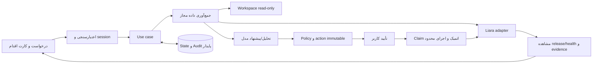

# معماری Launchlane

این سند ترکیبی از **وضعیت موجود** و **تصمیم پیشنهادی برای پیاده‌سازی** است. بخش‌های planned هنوز capability محصول نیستند. قرارداد API در `docs/api-capabilities.md` و OpenAPI مرجع در `docs/sources/` هستند؛ پذیرش محصول در `docs/acceptance.md` است.

## تصمیم‌ها و پیامدها

| ID | تصمیم داخلی | دلیل | پیامد/شرط بازنگری |
| --- | --- | --- | --- |
| D1 | Next.js App Router + React + TypeScript؛ Node 24.x؛ یک package | UI و API کنار هم، اشتراک قرارداد و کاهش سرویس‌های deploy | فقط Node runtime برای adapter/storage؛ ارتقای major خودسرانه ممنوع |
| D2 | اجرای operator-local و یک scope در MVP | دسترسی به پروژه کاربر و کاهش پیچیدگی auth/cloud upload | loopback کافی برای مجوز نیست؛ session/Origin/CSRF قبل از write؛ public SaaS نیازمند طراحی جدا |
| D3 | یک orchestrator محدود با ابزارهای typed | چرخه اصلی قابل پیش‌بینی است؛ انتخاب/توضیح و diagnosis از مدل کمک می‌گیرد | multi-agent/MCP wrapper فقط پس از evidence نیاز؛ no arbitrary shell |
| D4 | HTTP adapter مستقیم مبتنی بر OpenAPI؛ CLI رسمی فقط fallback مستند | کنترل timeout/خطا/آرگومان و تست قرارداد آسان‌تر | source archive/release protocol و team scope پیش از اولین write، live بررسی شود؛ endpoint نمونه غیررسمی مرجع نهایی نیست |
| D5 | SQLite با `node:sqlite` برای state عملیاتی در P1، پیش از P2 | approval و اثر نامطمئن باید restart را تحمل کند؛ DB service اضافی لازم نیست | اتصال/transaction کوتاه، یک process؛ module روی Node 24.18 این ماشین import شد، storage هنوز ساخته نشده؛ scale-out نیازمند بازنگری |
| D6 | مدل و SDK پس از compatibility smoke و بودجه | provider/model و دسترسی مجاز فعلاً مشخص نیست | یک adapter؛ مدل ارزان‌تر فقط اگر eval همان کیفیت را حفظ کند؛ بدون rewrite framework |
| D7 | Biome برای lint و منع `any` | سطح dependency کمتر؛ config اولیه ESLint وابستگی dev دارای advisory بدون fix سازگار داشت | typecheck و build جدا؛ lint شاهد امنیت محصول نیست |

Node 24.18.0 و SQLite 3.53.1 در محیط فعلی مشاهده شدند. نسخه‌های package دقیق در lockfile هستند. خود Next.js بر لیارا قابل استقرار است، اما این scaffold در این مرحله روی لیارا deploy نشده است. هیچ ORM یا migration runner فعلاً نصب/پیاده نشده است.

## ساختار موجود و هدف

موجود: `src/app/layout.tsx`، `src/app/page.tsx`، `src/app/api/health/route.ts`، `tests/bootstrap.test.mjs`، configها و این مستندات. پوشه‌های زیر **هنگام نیاز** ایجاد شوند؛ اسکلت خالی فراوان نسازیم:

```text
src/app/                 UI و route handlers باریک
src/components/          componentهای تجربه کاربر و action/evidence card
src/contracts/           ورودی/خروجی و schema اعتبارسنجی مرزها
src/server/application/  deployment، incident، approval و observation use cases
src/server/policy/       scope، ریسک، مجوز، budget، redaction و URL/path policy
src/server/agent/        مدل، ابزار محدود، interpretation و synthesis
src/server/liara/        HTTP client، capability و پاسخ normalize شده
src/server/workspace/    تشخیص read-only و archive manifest امن
src/server/persistence/  SQLite، repositoryها و migrations append-only
tests/                  قرارداد، state، failure injection، semantic و browser
docs/                   قراردادهای فنی، پذیرش و evidence قابل اشتراک
```

## جریان کنترل



read و تشخیص می‌توانند بدون تأیید هر بار انجام شوند، در محدوده session و app مجاز. create، upload، deploy، env، restart، resize و domain write، در MVP همگی approval لازم دارند. شارژ حساب و registrar identity دستی‌اند. این gate یک تصمیم معماری برای نسخه پایه است.

## مدل داده پیشنهادی؛ هنوز schema ساخته نشده

- `OperatorSession`: actor ID، expiry و scope؛ ورود با operator token قوی از env سمت سرور، مقایسه امن و تلاش محدود. session با secret جدا امضا می‌شود؛ کوکی HttpOnly و SameSite=Strict، Secure روی HTTPS، نه browser storage. token یا session secret خالی، دسترسی privileged را می‌بندد.
- `ProjectProfile`: runtime، port، نیاز env با **نام بدون مقدار**، build/start پیشنهادی، workspace/source fingerprint و اطلاعات نامعلوم.
- `Run`: intent، account/team/app، state، request ID، budget مصرف‌شده، زمان‌ها و revision/policy version.
- `Action`: operation enum، آرگومان غیرمحرمانه canonical، redacted preview، precondition، source archive hash، action hash، effect state و remote resource/release ID. مقدار env محرمانه در DB/model/audit ذخیره نمی‌شود؛ فقط opaque secret reference و digest کلیددار برای بستن approval به همان مقدار. secret واقعی در حافظه سمت سرور تا اجرای همان action است؛ برای action که هنوز attempt نشده، پس از restart یا نبود reference، `needs_input` و approval تازه لازم است. اگر attempt قبلی ممکن است اثر کرده باشد، ابتدا قواعد `uncertain` و reconcile اجرا می‌شوند؛ نبود secret مجوز write تازه نیست.
- `Approval`: actor/session/action hash، expiry، decision و consumedAt؛ unique و single-use.
- `Observation`: منبع، app/release، بازه/زمان، unit، داده پاک‌شده و evidence ID؛ absent از zero جدا باشد.
- `Incident`: symptom، observations، hypotheses با evidence و uncertainty، پیشنهاد و نتیجه قبل/بعد.
- `AuditEvent`: transition، actor، action/request ID، attempt، خطای sanitized؛ نگهداری حداقلی و بدون secret.

SQL با parameter binding؛ migration شماره‌دار، checksum و transaction. history اعمال‌شده تغییر نکند. آزمایش migration روی DB موقت، upgrade و restart الزامی است. اگر storage در دسترس نیست، **write بسته می‌ماند**؛ fallback حافظه‌ای برای approval مجاز نیست.

## state و اجرای عملیات

`planned → awaiting_approval → approved → executing → observing → succeeded/failed`؛ حالات جانبی `needs_input`، `cancelled` و `uncertain`.

پیش از side effect، approval و precondition روی server بازبینی و action در transaction به executing منتقل شود؛ درخواست هم‌زمان/تکراری همان action مجوز اجرای دوباره ندارد. هزینه/پلن، مقصد، source hash یا آرگومان عوض شود، approval قبلی معتبر نیست. کل bundle چندعملیاتی فقط وقتی یک approval دارد که تمام actionها و اثرهایش نمایش داده و به همان hash بسته شده باشند؛ در غیر این صورت تأیید جدا.

پاسخ upload/release فقط پذیرش درخواست است. شناسه را persist و وضعیت release و workload را بخوانیم. عملیات async را در بازه محدود observe کنیم؛ اگر هنوز build ادامه دارد، `observing` و امکان readback بعدی، نه موفقیت یا failure ساختگی. برای این MVP daemon ۲۴ساعته لازم نیست.

در startup/recovery، action دارای attempt پایدار در `executing` یا `observing` هرگز مستقیم به ready/approved برنگردد. ابتدا اثر آن را با readback محدود بررسی کنیم؛ `observing` فقط خواندن نتیجه را ادامه می‌دهد و `executing` بدون نتیجه قطعی، `uncertain` است. نبود secret در حافظه یا approval تازه، این ترتیب را دور نمی‌زند. عملیات متعارض بعدی در همان app تا تعیین اثر قبلی مسدود است؛ read همچنان مجاز است. تنها پس از تعیین قطعی عدم اجرا، می‌توان action تازه با ورودی و approval تازه ساخت. correlation ناکافی یعنی unknown و مسیر حل صریح، نه اجرای دوباره.

timeout بعد از احتمال write: `uncertain`؛ write خودکار تکرار نشود. scope/release/events و precondition برای reconcile خوانده شود. correlation قطعی در دسترس نیست، نامعلوم بماند و کاربر مسیر حل داشته باشد. پشتیبانی idempotency سمت لیارا فرض نشده است.

## API داخلی پیشنهادی؛ فعلاً فقط health موجود است

| مسیر هدف | مسئولیت و شرط |
| --- | --- |
| `GET /api/health` | موجود؛ liveness scaffold، بدون اثبات readiness خارجی |
| `POST /api/session` | ورود با operator token؛ host/Origin معتبر، rate limit و کوکی session؛ secret هرگز در URL |
| `GET /api/capabilities` | scope مجاز و available/unavailable/unverified با دلیل |
| `POST /api/projects/inspect` | خواندن محدود پروژه زیر workspace مجاز؛ بدون اجرای scripts |
| `POST /api/runs` | درخواست کاربر، جمع‌آوری evidence و پیشنهاد action/diagnosis |
| `GET /api/runs/{id}` | وضعیت/شواهد sanitized با کنترل مالکیت |
| `POST /api/actions/{id}/decision` | approve/reject همان action hash؛ CSRF/session/expiry |
| `POST /api/actions/{id}/execute` | claim اتمیک و اجرای تأییدشده؛ server policy |
| `POST /api/actions/{id}/observe` | readback محدود؛ بدون بازاجرای write |
| `POST /api/incidents` | تشخیص بر اساس app/time scope؛ همان runtime و evidence |
| `GET /api/incidents/{id}/handoff` | بسته پاک‌شده برای Coding Agent، بدون ارتباط خارجی خودکار |

نام routeها طرح داخلی‌اند و API لیارا نیستند. Coding Agent هنگام ساخت می‌تواند آن‌ها را ساده کند، مشروط به حفظ پذیرش و به‌روزرسانی سند. Error envelope پیشنهادی: `{error:{code,message,retryable,requestId,actionId?}}`، موفقیت/unknown به‌صورت discriminated union. کدهای policy، auth، unavailable، rate_limit، upstream و uncertain از هم جدا باشند.

## Liara adapter و ارتباط اجزا

[docs/api-capabilities.md](docs/api-capabilities.md) endpointهای **مستند** و gate بررسی زنده را دارد. default PaaS base همان `https://api.liara.ir` است؛ token با Bearer و teamID مطابق حساب. اطلاعات/URL مدل جداست و Liara PaaS token به model provider فرستاده نمی‌شود.

responseها `unknown` دریافت و validate شوند. timestamp/واحد متریک و logs را از live response و schema تأیید کنیم. plan catalog/قیمت اگر از API معتبر قابل دریافت نیست، fallback شفاف به انتخاب کاربر/منبع رسمی تاریخ‌دار؛ نه قیمت hardcode. CPU/RAM unavailable یعنی unknown، نه zero/healthy.

پیشنهاد resource از project profile و budget کاربر + evidence است. علت incident به logs/events/metrics همان بازه متصل باشد؛ افزایش CPU به‌تنهایی proof root cause نیست. هیچ regression با افزایش confidence یا کلمات ثابت پنهان نشود.

## مرزهای امنیتی و اجرای محدود

Boundaryها: browser→session/API؛ محتوا/مدل→policy؛ policy→Liara؛ filesystem→archive؛ provider output→evidence؛ durable state→approval. همه APIهای privileged شامل خواندن پروژه/logها احراز هویت می‌خواهند؛ فقط health عمومی محلی است. loopback جایگزین authentication نیست.

مسیر filesystem canonical/realpath و symlink بررسی شود. archive سقف اندازه/تعداد و exclude secrets داشته باشد؛ app نامعتبر، absolute URL دلخواه و shell command تولیدشده اجرا نشوند. health probe باید host معتبر همان app و redirect کنترل‌شده داشته باشد. رمز در env سمت server بماند؛ انتقال logs/code به مدل با redaction و کمترین حجم لازم.

پیش‌فرض داخلی پیشنهادی در `.env.example`: ۸ model request، ۱۲ tool call، deadline فعال ۱۲۰ ثانیه و هم‌زمانی write یک per-app. همه retry/repair در همین allowance حساب شوند؛ خلاصه‌سازی و مدل دوم رایگان فرض نشوند. این اعداد پیش‌فرض داخلی‌اند و با trace کوچک قابل اصلاح‌اند. observe طولانی به readback بعدی منتقل شود؛ reset خاموش بودجه یا success ساختگی مجاز نیست.

## وضعیت وابستگی‌ها

مدل/SDK، validation library و SQLite adapter هنوز پیاده نشده‌اند. SDK را پس از smoke واقعی tool calling/structured output/stream انتخاب کنیم؛ این foundation به provider خاص یا framework بزرگ وابسته نیست. هیچ source از مخزن قبلی یا GitHub بدون بازبینی compatibility/license کپی نشده است. طرح جایگزین MCP-only مجاز است اما برای UX کاربر کم‌تجربه، وب‌اپ تصمیم اولیه ماست.
