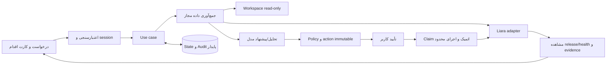

# معماری Launchlane

این سند ترکیبی از **وضعیت موجود** و **تصمیم پیشنهادی برای پیاده‌سازی** است. بخش‌های planned هنوز capability محصول نیستند. قرارداد API در `docs/api-capabilities.md` و OpenAPI مرجع در `docs/sources/` هستند؛ پذیرش محصول در `docs/acceptance.md` است.

## انتشار محدود؛ قرارداد پیاده‌شده در ۲۰۲۶-۱۰-۲۲

`application/deployment.ts` مسیر پیشنهاد اجرایی→اجرای تأییدشده→مشاهده مستقل را روی لایه‌های موجود پیاده می‌کند. `propose-deploy` فقط با هر دو gate مجاز، اتصال actor-bound، app Node موجود، پلن قابل خواندن و origin ازپیش‌مجاز پذیرفته می‌شود. ActionSpec v4 علاوه بر ورودی‌های v3، `targetAppId`، پلن فعلی و `workload {origin,path,status,revision}` را در hash می‌بندد؛ `planId` یک precondition است و resize انجام نمی‌شود. canonicalization v1/v2/v3 حفظ شده و پیشنهادهای تاریخی برای ارسال نیازمند پیشنهاد v4 تازه‌اند.

پیش از claim، app/plan/source/connection بازبینی و بودجه دو write و دو بررسی app/plan کنترل می‌شود. migration 6 فقط جدول journal انتشار را اضافه می‌کند؛ تاریخچه قبلی تغییر نمی‌کند. claim و مرحله ابتدایی اتمیک‌اند. شروع upload پیش از شبکه، رسید source پیش از release و رسید release همراه انتقال به observing ذخیره می‌شوند. adapter فقط bytes بررسی‌شده را در multipart با field رسمی `file` و سپس JSON `sourceID/port/type` ارسال می‌کند؛ مسیر/اسکریپت پروژه را اجرا یا دوباره نمی‌خواند. POST هیچ retry ندارد. پاسخ گم‌شده، malformed، cancel یا قطع فرایند پس از claim به uncertain می‌رود و عملیات متعارض را می‌بندد. منبعِ پذیرفته‌شده حتی پس از قطع اتصال محلی حفظ می‌شود؛ قطع اتصال اجازه مرحله بعد نیست.

`POST /api/actions/{id}/observe` فقط خواندن محدود انجام می‌دهد و به gate mutation وابسته نیست. نسخه باید در صفحه محدود release دیده، READY و current باشد. probe همان origin/path با سیاست DNS/TLS/حجم موجود، status دقیق و JSON با فیلد متنی `revision` برابر انتظار را می‌خواهد؛ پروژه/پلن و release پس از probe موفق دوباره خوانده می‌شوند. 404، نسخه قدیمی یا healthz بدون revision موفق نیستند. build در حال اجرا، unavailable و پاسخ نامعلوم به مشاهده بعدی منتقل می‌شوند. receipt نامعلوم با حدس به release آخر متصل نمی‌شود و خودکار unblock نمی‌شود. مشاهده به action تاریخی تعلق دارد و به فعال‌بودن source همان پروژه نیاز ندارد؛ اتصال همان actor/team/app identity همچنان الزامی است.

حدود: فقط GET با JSON revision کوچک، صفحه اول حداکثر 50 release و یک round خواندن در هر درخواست؛ بدون daemon، rollback یا shell. origin محلی انتخاب‌شده اثبات مالکیت DNS نیست. API نام‌محور Liara، قفل/CAS مستند روی identity/plan بین preflight و write ندارد؛ readback این race خارجی را اتمیک نمی‌کند. shape، هزینه، semantics حفظ env در release و رفتار واقعی حساب هنوز به T20 و مجوز محدود زنده وابسته‌اند. هیچ write واقعی در اعتبارسنجی این برش انجام نشده است.

## خواندن محدود و هویت گزارش incident

در مسیر اصلی `incident/runs.ts`، reader شناسه داخلی app انتخاب‌شده را از اتصال actor-bound می‌گیرد. collector پیش از خواندن log/workload و دوباره پیش از تحویل snapshot، همان شناسه را با پاسخ تازه project تطبیق می‌دهد؛ تغییر app هم‌نام کل snapshot را رد می‌کند. پاسخ project اولیه برای نام envها استفاده می‌شود. این مسیر یک خواندن اضافه دارد: هشت tool call در حالت کامل، همگی در همان budget و بدون retry. endpoint قدیمی evidence فقط قرارداد team/app name را دارد و گزارش ماندگار این مسیر محسوب نمی‌شود.

پنجره خودکار از پنج دقیقه پیش از شروع تا deadline بودجه است و هنگام پایان به زمان جمع‌آوری واقعی محدود می‌شود؛ timestamp هر مشاهده محلی در زمان دریافت ثبت می‌شود. پنجره تاریخی صریح به اکنون گسترش نمی‌یابد و زمان خام log همچنان به واحد حدسی تبدیل نمی‌شود. app identity fence قفل upstream نیست و نسخه release مربوط به هر log را اثبات نمی‌کند.

خواندن provider و اعتبارسنجی اتصال، انتظار برای header و body را با abort/deadline محدود می‌کنند، حتی اگر transport به signal واکنش ندهد. درخواست تکرار نمی‌شود و پاسخ دیررس اتصال تازه‌ای ذخیره نمی‌کند؛ پایان انتظار client اثبات توقف پردازش upstream نیست. schema، زمان و واحد واقعی حساب همچنان live unverified هستند.

## جریان پروژه و حساب‌ها؛ backend پیاده‌شده

API project-flows انتخاب محلی/نمونه/GitHub را به بررسی ایستا و آماده‌سازی خودکار archive خصوصی وصل می‌کند. UI از همین مسیر استفاده می‌کند. انتخاب و profile در SQLite به actor متصل‌اند؛ URL فقط شناسه flow را می‌گیرد و هیچ کد/credential در browser storage ذخیره نمی‌شود. بازیابی، محتوای فعلی و archive را بررسی می‌کند؛ انتخاب تازه یا محتوای تغییرکرده پیشنهاد قبلی را باطل می‌کند. ActionSpec v3 علاوه بر source/archive، flow و selectionHash شامل هویت مخزن/شاخه/revision/زیرپوشه را می‌بندد. v1/v2 برای تاریخچه حفظ شده‌اند.

GitHub از CLI رسمی pinned برای device login و خواندن API استفاده می‌کند؛ credential باید در keyring باشد و هویت واقعی پیش از تأیید حساب/خواندن catalog تطبیق داده می‌شود. دریافت روی commit دقیق و با tar/gzip محدود انجام می‌شود؛ script، hooks و کد پروژه اجرا نمی‌شوند. مسیر ورودی از مرورگر، filesystem سرور و نسخه GitHub سه مفهوم متفاوت‌اند؛ upload پوشه مرورگر در این نسخه پیاده نشده است. snapshotهای GitHub در state خصوصی جدا از workspace مجاز نگه داشته می‌شوند.

اتصال Liara با کلید و سه GET صریح برای هویت/تیم/برنامه‌ها اعتبارسنجی و به‌صورت رمز‌شده ذخیره می‌شود. تنها تیم ثابت و انتخاب صریح یک app محدوده عملیات را می‌سازند. اتصال، gate شواهد یا mutation را فعال نمی‌کند؛ روش انتخاب و trade-offهای ورود در [تصمیم اتصال‌ها](docs/decisions/0001-account-connections.md) ثبت شده‌اند. هیچ grant واقعی GitHub یا اتصال حساب Liara در این مرحله تأیید نشده است.

refresh هویت داخلی app را نیز بررسی می‌کند: app جدید با نام قبلی، تأیید یا نشانی بررسی قبلی را ارث نمی‌برد. گزارش incident به شناسه داخلی app هم متصل است؛ گزارش تاریخی فاقد این شناسه نمایش داده می‌شود ولی برای تحلیل یا بررسی دوباره نیاز به شروع تازه دارد. این داده در JSON رکورد موجود ذخیره می‌شود و migration اعمال‌شده تغییر نمی‌کند.

## تصمیم‌ها و پیامدها

نتیجه incident و نشانی سایت برای بررسی در migration 5 به SQLite افزوده شده‌اند. run شامل شواهد محدود و پاک‌سازی‌شده، نوع واقعی/نمونه و وضعیت مستقل توضیح علت است؛ browser storage وارد این مسیر نمی‌شود. مدل فقط پس از claim پایدار و اتمیک همان run فراخوانی می‌شود؛ pending پس از restart به failed می‌رود و بازپخش خودکار ندارد. رقابت با recheck از طریق updatedAt یکنواخت و CAS رد می‌شود. ثبت نشانی سایت یک مجوز خواندن محلی، متصل به actor/team/app انتخابی است؛ مالکیت DNS سرویس را اثبات نمی‌کند و تغییر دامنه زیرساختی نیست. تنظیم ثابت مدیر نصب مقدم است و درخواست واقعی همچنان از DNS عمومی/pin/TLS و gate سرویس عبور می‌کند. UI عادی برنامه/نشانه/صفحه و نمونه اختیاری از API runs استفاده می‌کنند؛ گزارش اولیه/تازه و وضعیت تحلیل پس از reload بازیابی می‌شوند.

| ID | تصمیم داخلی | دلیل | پیامد/شرط بازنگری |
| --- | --- | --- | --- |
| D1 | Next.js App Router + React + TypeScript؛ Node 24.x؛ یک package | UI و API کنار هم، اشتراک قرارداد و کاهش سرویس‌های deploy | فقط Node runtime برای adapter/storage؛ ارتقای major خودسرانه ممنوع |
| D2 | اجرای operator-local و یک scope در MVP | دسترسی به پروژه کاربر و کاهش پیچیدگی auth/cloud upload | loopback کافی برای مجوز نیست؛ session/Origin/CSRF قبل از write؛ public SaaS نیازمند طراحی جدا |
| D3 | یک orchestrator محدود با ابزارهای typed | چرخه اصلی قابل پیش‌بینی است؛ انتخاب/توضیح و diagnosis از مدل کمک می‌گیرد | multi-agent/MCP wrapper فقط پس از evidence نیاز؛ no arbitrary shell |
| D4 | HTTP adapter مستقیم مبتنی بر OpenAPI؛ CLI رسمی فقط fallback مستند | کنترل timeout/خطا/آرگومان و تست قرارداد آسان‌تر | source archive/release protocol و team scope پیش از اولین write، live بررسی شود؛ endpoint نمونه غیررسمی مرجع نهایی نیست |
| D5 | SQLite با `node:sqlite`، implemented_offline | approval و اثر نامطمئن باید restart را تحمل کند؛ DB service اضافی لازم نیست | migration/checksum، race و recovery روی Node 24.18 تست شده؛ فقط یک process؛ [ADR](docs/decisions/0001-local-workflow.md) |
| D6 | BoxAPI؛ transport مستقیم chat-completions، بدون SDK تازه | provider با دستور مالک مشخص است؛ کنترل مقصد و بودجه ساده می‌ماند | gpt-6-luna/none یک tool/result/terminal واقعی را گذرانده؛ کیفیت diagnosis همچنان به oracle مستقل وابسته است |
| D7 | Biome برای lint و منع `any` | سطح dependency کمتر؛ config اولیه ESLint وابستگی dev دارای advisory بدون fix سازگار داشت | typecheck و build جدا؛ lint شاهد امنیت محصول نیست |

Node 24.18.0 و SQLite 3.53.1 در محیط فعلی مشاهده شدند. نسخه‌های package دقیق در lockfile هستند. محصول در این مرحله روی Liara deploy نشده است. ORM نصب نشده؛ migration runner کوچک با transaction و checksum در persistence پیاده شده است.

## ساختار موجود و هدف

موجود: workbench، contracts، session/policy، source inspector، persistence، APIهای محلی، workflow محدود deployment/incident و transportهای model/Liara. ساختار زیر بر حسب نیاز پر شده است؛ اتصال و اجرای زنده workflowها هنوز تأیید نشده‌اند:

```text
src/app/                 UI و route handlers باریک
src/components/          componentهای تجربه کاربر و action/evidence card
src/contracts/           ورودی/خروجی و schema اعتبارسنجی مرزها
src/server/application/  deployment، incident، approval و observation use cases
src/server/policy/       scope، ریسک، مجوز، budget، redaction و URL/path policy
src/server/agent/        مدل، ابزار محدود، interpretation و synthesis
src/server/liara/        HTTP client، capability و پاسخ normalize شده
src/server/workspace/    تشخیص read-only، capture محدود و archive خصوصی
src/server/persistence/  SQLite، repositoryها و migrations append-only
tests/                  قرارداد، state، failure injection، semantic و browser
docs/                   قراردادهای فنی، پذیرش و evidence قابل اشتراک
```

## جریان کنترل



read و تشخیص می‌توانند بدون تأیید هر بار انجام شوند، در محدوده session و app مجاز. create، upload، deploy، env، restart، resize و domain write، در MVP همگی approval لازم دارند. شارژ حساب و registrar identity دستی‌اند. این gate یک تصمیم معماری برای نسخه پایه است.

## مدل داده؛ موجود و برنامه‌ریزی‌شده

موجود در migration شماره ۱: sessions، login_limits، actions، attempts، audit_events و schema_migrations. migration شماره ۲ جدول `source_artifacts` را اضافه می‌کند؛ migration قبلی تغییر نکرده است. `ProjectProfile` و manifest پاسخ محلی‌اند؛ مشخصات archive شامل actor، source hash، archive hash، حجم، تعداد فایل و زمان در SQLite می‌مانند. Run/Observation/Incident و env secret reference زیر هنوز طرح‌اند. در P1 فقط deploy/restart به‌عنوان operation معتبرند؛ سایر نام‌ها رد می‌شوند.

- `OperatorSession`: actor ID، expiry و scope؛ ورود با operator token قوی از env سمت سرور، مقایسه امن و تلاش محدود. session با secret جدا امضا می‌شود؛ کوکی HttpOnly و SameSite=Strict، Secure روی HTTPS، نه browser storage. token یا session secret خالی، دسترسی privileged را می‌بندد.
- `ProjectProfile`: runtime، port، نیاز env با **نام بدون مقدار**، build/start پیشنهادی، workspace/source fingerprint و اطلاعات نامعلوم.
- `Run`: intent، account/team/app، state، request ID، budget مصرف‌شده، زمان‌ها و revision/policy version.
- `Action`: operation enum، آرگومان غیرمحرمانه canonical، redacted preview، precondition، source archive hash، action hash، effect state و remote resource/release ID. مقدار env محرمانه در DB/model/audit ذخیره نمی‌شود؛ فقط opaque secret reference و digest کلیددار برای بستن approval به همان مقدار. secret واقعی در حافظه سمت سرور تا اجرای همان action است؛ برای action که هنوز attempt نشده، پس از restart یا نبود reference، `needs_input` و approval تازه لازم است. اگر attempt قبلی ممکن است اثر کرده باشد، ابتدا قواعد `uncertain` و reconcile اجرا می‌شوند؛ نبود secret مجوز write تازه نیست.
- `Approval`: actor/session/action hash، expiry، decision و consumedAt؛ unique و single-use.
- `Observation`: منبع، app/release، بازه/زمان، unit، داده پاک‌شده و evidence ID؛ absent از zero جدا باشد.
- `Incident`: symptom، observations، hypotheses با evidence و uncertainty، پیشنهاد و نتیجه قبل/بعد.
- `AuditEvent`: transition، actor، action/request ID، attempt، خطای sanitized؛ نگهداری حداقلی و بدون secret.

SQL با parameter binding؛ migration شماره‌دار، checksum و transaction. history اعمال‌شده تغییر نکند. آزمایش migration روی DB موقت، upgrade و restart الزامی است. اگر storage در دسترس نیست، **write بسته می‌ماند**؛ fallback حافظه‌ای برای approval مجاز نیست.

### snapshot و artifact؛ پیاده‌شده آفلاین

`prepare-source` فقط یک capture هم‌زمان در process مجاز می‌کند. scanner همان کنترل‌های path/secret و سقف ۲۰ MiB/۱۰۰۰ فایل را برای manifest و بایت‌های snapshot اجرا می‌کند. `tar-stream@3.2.2` فقط bufferهای بررسی‌شده را encode می‌کند؛ filesystem را دوباره نمی‌خواند. dependency برای پشتیبانی USTAR/PAX، Unicode و مسیر بلند انتخاب شد تا serializer تازه یا shell لازم نباشد. فایل‌ها مرتب، بدون link/directory special entry، با mode=0644، uid/gid=0 و mtime=epoch بسته می‌شوند. gzip level=6 است؛ روی runtime/config یکسان، تغییر صرف timestamp هش بسته را تغییر نمی‌دهد.

archive در `source-artifacts/{sha256}.tar.gz` زیر stateDir خصوصی ساخته می‌شود: فایل موقت exclusive، flush، publish بدون overwrite و بازخوانی/hash check؛ سپس receipt در SQLite ثبت می‌شود. orphan بدون receipt مجوز ایجاد نمی‌کند. سقف gzip برابر ۲۴ MiB و نگهداری برابر ۱۲۸ MiB/۳۲ فایل است؛ پاک‌سازی خودکار نداریم. storage به filesystem دارای hard-link متکی است؛ NTFS محیط فعلی آزموده شده و خطای آن fail closed است. پوشه لینک‌شده و فایل تغییرکرده رد می‌شوند. ACL میزبان و حمله یک فرایند محلی هم‌سطح، یک sandbox امنیتی مستقل نیستند.

ActionSpec v2، source hash و archive hash را جداگانه در action hash می‌بندد. نسخه‌های تاریخی با همان canonicalization خوانده می‌شوند. پیش از claim، archive موجود با receipt/hash بررسی و buffer همان snapshot به adapter داده می‌شود؛ فایل فعلی workspace جایگزین source مورد تأیید نمی‌شود. مسیر اجرایی جدید به v4 محدود است و با transport مصنوعی آزموده شده؛ هیچ source upload واقعی لیارا انجام نشده است.

## state و اجرای عملیات

`planned → awaiting_approval → approved → executing → observing → succeeded/failed`؛ حالات جانبی `needs_input`، `cancelled` و `uncertain`.

پیش از side effect، approval و precondition روی server بازبینی و action در transaction به executing منتقل شود؛ درخواست هم‌زمان/تکراری همان action مجوز اجرای دوباره ندارد. هزینه/پلن، مقصد، source hash یا آرگومان عوض شود، approval قبلی معتبر نیست. کل bundle چندعملیاتی فقط وقتی یک approval دارد که تمام actionها و اثرهایش نمایش داده و به همان hash بسته شده باشند؛ در غیر این صورت تأیید جدا.

پاسخ upload/release فقط پذیرش درخواست است. شناسه را persist و وضعیت release و workload را بخوانیم. عملیات async را در بازه محدود observe کنیم؛ اگر هنوز build ادامه دارد، `observing` و امکان readback بعدی، نه موفقیت یا failure ساختگی. برای این MVP daemon ۲۴ساعته لازم نیست.

در startup/recovery، action دارای attempt پایدار در `executing` یا `observing` هرگز مستقیم به ready/approved برنگردد. ابتدا اثر آن را با readback محدود بررسی کنیم؛ `observing` فقط خواندن نتیجه را ادامه می‌دهد و `executing` بدون نتیجه قطعی، `uncertain` است. نبود secret در حافظه یا approval تازه، این ترتیب را دور نمی‌زند. عملیات متعارض بعدی در همان app تا تعیین اثر قبلی مسدود است؛ read همچنان مجاز است. تنها پس از تعیین قطعی عدم اجرا، می‌توان action تازه با ورودی و approval تازه ساخت. correlation ناکافی یعنی unknown و مسیر حل صریح، نه اجرای دوباره.

timeout بعد از احتمال write: `uncertain`؛ write خودکار تکرار نشود. scope/release/events و precondition برای reconcile خوانده شود. correlation قطعی در دسترس نیست، نامعلوم بماند و کاربر مسیر حل داشته باشد. پشتیبانی idempotency سمت لیارا فرض نشده است.

## API داخلی موجود و مسیرهای بعدی

موجود: health، session (POST/DELETE)، `GET /api/workspace`، inspect/archive/project-flows، connectionها، actions/decision/execute/observe و incident runs/evidence/practice. execute جدید برای v4 به transport محدود متصل است اما gateها خاموش و live unverified هستند. handoff و routeهای عمومی runs در جدول زیر همچنان طرح‌اند؛ capabilities در workspace ادغام شده است.

| مسیر هدف | مسئولیت و شرط |
| --- | --- |
| `GET /api/health` | موجود؛ liveness scaffold، بدون اثبات readiness خارجی |
| `POST /api/session` | ورود با operator token؛ host/Origin معتبر، rate limit و کوکی session؛ secret هرگز در URL |
| `GET /api/capabilities` | scope مجاز و available/unavailable/unverified با دلیل |
| `POST /api/projects/inspect` | خواندن محدود پروژه زیر workspace مجاز؛ بدون اجرای scripts |
| `POST /api/projects/folders` | موجود؛ dialog پوشه‌های سرور محلی، ریشه مشخص و pagination؛ session/Origin/CSRF، بدون گسترش دسترسی دیسک |
| `POST /api/projects/archive` | موجود؛ session/Origin/CSRF، source hash فعلی، tar.gz محلی و receipt؛ بدون تماس provider |
| `POST /api/runs` | درخواست کاربر، جمع‌آوری evidence و پیشنهاد action/diagnosis |
| `GET /api/runs/{id}` | وضعیت/شواهد sanitized با کنترل مالکیت |
| `POST /api/actions/{id}/decision` | approve/reject همان action hash؛ CSRF/session/expiry |
| `POST /api/actions/{id}/execute` | claim اتمیک و اجرای تأییدشده؛ server policy |
| `POST /api/actions/{id}/observe` | readback محدود؛ بدون بازاجرای write |
| `POST /api/incidents` | تشخیص بر اساس app/time scope؛ همان runtime و evidence |
| `POST /api/incidents/evidence` | موجود؛ session/Origin/CSRF، app/since/path/window معتبر، هفت read مستقل؛ gate Liara خاموش؛ بدون مدل/write |
| `POST /api/incidents/practice` | موجود؛ فقط fixture با mode=simulated و analysis=scripted، صفر provider request؛ تشخیص و مقایسه تمرینی |
| `GET /api/incidents/{id}/handoff` | بسته پاک‌شده برای Coding Agent، بدون ارتباط خارجی خودکار |

نام routeها طرح داخلی‌اند و API لیارا نیستند. Coding Agent هنگام ساخت می‌تواند آن‌ها را ساده کند، مشروط به حفظ پذیرش و به‌روزرسانی سند. Error envelope پیشنهادی: `{error:{code,message,retryable,requestId,actionId?}}`، موفقیت/unknown به‌صورت discriminated union. کدهای policy، auth، unavailable، rate_limit، upstream و uncertain از هم جدا باشند.

## Liara adapter و ارتباط اجزا

[docs/api-capabilities.md](docs/api-capabilities.md) endpointهای **مستند** و gate بررسی زنده را دارد. default PaaS base همان `https://api.liara.ir` است؛ token با Bearer و teamID مطابق حساب. اطلاعات/URL مدل جداست و Liara PaaS token به model provider فرستاده نمی‌شود.

responseها `unknown` دریافت و validate شوند. timestamp/واحد متریک و logs را از live response و schema تأیید کنیم. plan catalog/قیمت اگر از API معتبر قابل دریافت نیست، fallback شفاف به انتخاب کاربر/منبع رسمی تاریخ‌دار؛ نه قیمت hardcode. CPU/RAM unavailable یعنی unknown، نه zero/healthy.

پیشنهاد resource از project profile و budget کاربر + evidence است. علت incident به logs/events/metrics همان بازه متصل باشد؛ افزایش CPU به‌تنهایی proof root cause نیست. هیچ regression با افزایش confidence یا کلمات ثابت پنهان نشود.

## مرزهای امنیتی و اجرای محدود

Boundaryها: browser→session/API؛ محتوا/مدل→policy؛ policy→Liara؛ filesystem→archive؛ provider output→evidence؛ durable state→approval. همه APIهای privileged شامل خواندن پروژه/logها احراز هویت می‌خواهند؛ فقط health عمومی محلی است. loopback جایگزین authentication نیست.

مسیر filesystem canonical/realpath و symlink بررسی شود. archive سقف اندازه/تعداد و exclude secrets داشته باشد؛ app نامعتبر، absolute URL دلخواه و shell command تولیدشده اجرا نشوند. health probe باید host معتبر همان app و redirect کنترل‌شده داشته باشد. رمز در env سمت server بماند؛ انتقال logs/code به مدل با redaction و کمترین حجم لازم.

پیش‌فرض داخلی پیشنهادی در `.env.example`: ۸ model request، ۱۲ tool call، deadline فعال ۱۲۰ ثانیه و هم‌زمانی write یک per-app. همه retry/repair در همین allowance حساب شوند؛ خلاصه‌سازی و مدل دوم رایگان فرض نشوند. این اعداد پیش‌فرض داخلی‌اند و با trace کوچک قابل اصلاح‌اند. observe طولانی به readback بعدی منتقل شود؛ reset خاموش بودجه یا success ساختگی مجاز نیست.

## وضعیت وابستگی‌ها

نگهداری اتصال actor-bound با migration 3 اضافه شده است؛ credential Liara با AES-256-GCM و AAD همان actor/provider ذخیره می‌شود. رابط اتصال و validation upstream پیاده‌اند؛ فقط پاسخ معتبر هویت/تیم/برنامه‌ها اتصال را ثبت می‌کند. آزمون حساب واقعی باقی است و وجود row یا token نشانه تأیید زنده سرویس نیست. دلیل انتخاب روش ورود در [تصمیم اتصال حساب‌ها](docs/decisions/0001-account-connections.md) ثبت است. migrationهای قبلی بدون تغییر مانده‌اند.

validation صریح با `unknown` و narrowing، SQLite adapter و transportهای کوچک پیاده شده‌اند؛ SDK مدل، ORM، queue و framework Agent نصب نشده‌اند. browser/axe فقط dependency توسعه‌اند. readهای محدود Liara و probe با origin allowlist، DNS pin و رد redirect ساخته و با transport مصنوعی آزموده شده‌اند؛ هیچ تماس واقعی Liara ندارند. collector خطای هر منبع را از empty/unknown جدا می‌کند؛ زمان خام نامعلوم به زمان deploy تبدیل نمی‌شود. diagnosis runtime به snapshot ثابت همان scope و یک evidence tool محدود است؛ قبل از terminal باید tool result خوانده شود. خروجی حداکثر سه فرضیه و next check است؛ citation/time validation اثبات صحت معنایی یا کیفیت مدل نیست.

UI تمرینی از scripted model مستقل استفاده می‌کند و هرگز fallback شکست provider نیست. مقایسه symptom فقط همان app/origin/path و مشاهده تازه را می‌پذیرد؛ این helper هیچ action را succeeded نمی‌کند و اثر env/release را اثبات نمی‌کند. snapshot/diagnosis با GET/POST `/api/incidents/runs` در SQLite نگهداری و با کنترل مالکیت بازیابی می‌شوند. مسیر write محدود deploy در بخش جاری این سند شرح داده شده؛ ابزار env و اصلاح incident متصل نیستند. مدل واقعی باید روی همان protocol و oracle مستقل سنجیده شود؛ transport compatibility جای آن نیست.
