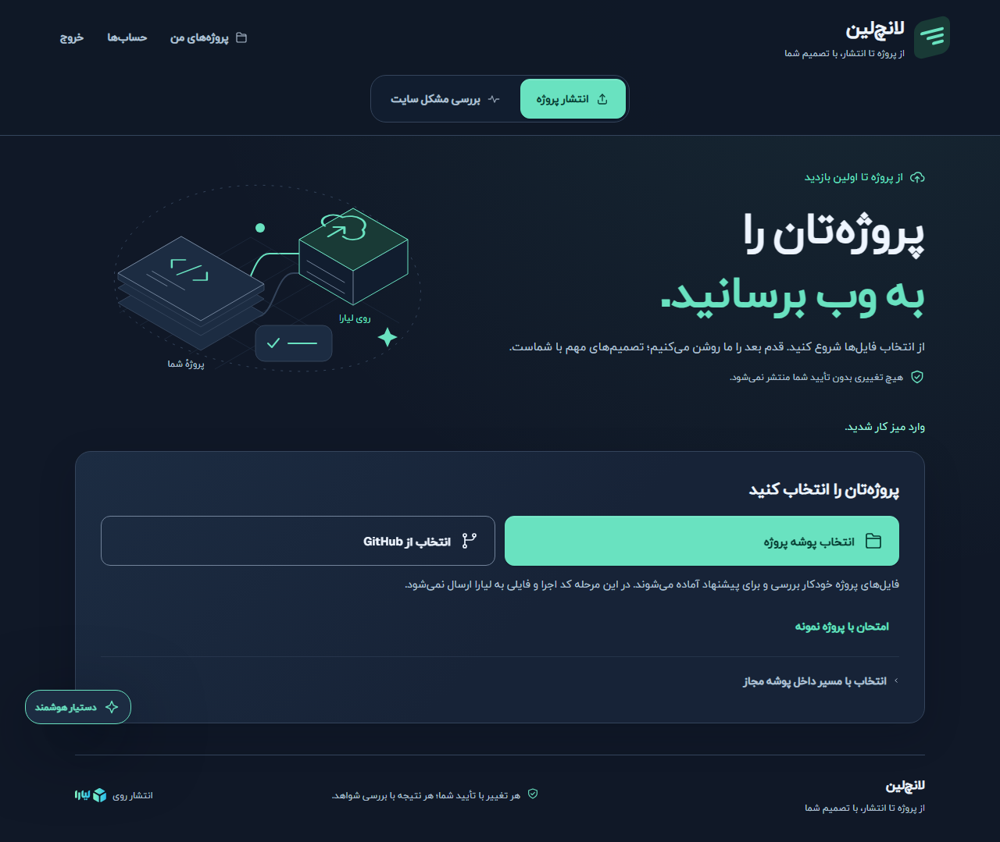
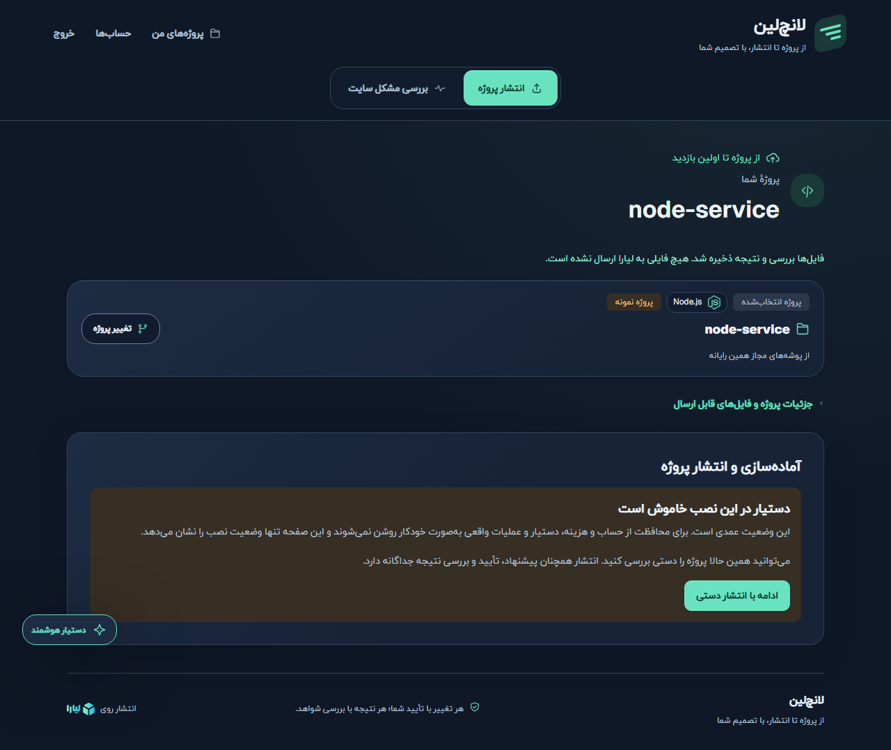
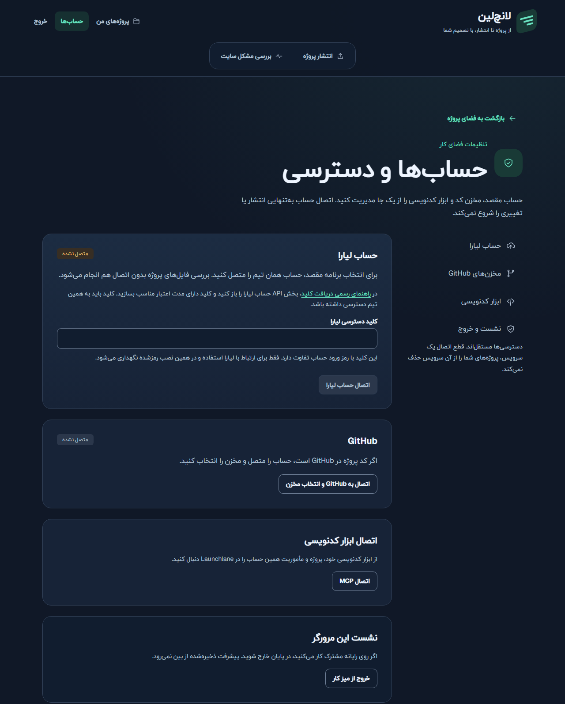
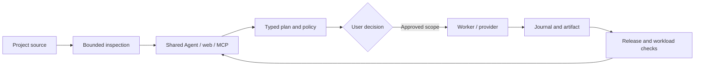

[فارسی](README.md) · [Setup](docs/setup.md) · [Platform support](docs/platform-support.md)


# Launchlane

**From project source to a Liara deployment, with your decision and a verifiable result.**

Launchlane is a web workbench for understanding projects, bounded preparation and repair, deployment, and site investigation. Introduce a local folder or GitHub project; the Agent uses the application's real tools, presents changes for review, and binds results to the selected artifact and release. The interface is Persian. Chat is optional alongside the guided publication flow.

[](package.json)
[](LICENSE)



Actual application UI in an isolated local session with test data. These images are not cloud deployment evidence. [Capture details and reproduction](docs/assets/readme/README.md).

**Under active development:** executable paths exist for the target families, but complete deployment of every project and production acceptance of all 14 families remain open. A successful build, ready release, HTTP response, and correct data are separate criteria. See [capabilities and limits](docs/platform-support.md) and [versioned verification](docs/verification.md).

## Your first result, without service keys

A **fresh private installation** needs Git, npm, and **Node.js 24.15+ within 24.x**. The validated local host is Windows/PowerShell with Node 24.18.0. These commands work unchanged in PowerShell and POSIX shells; dependency downloads need internet access. This path needs no Docker, Liara account, or model key.

```sh
git clone https://github.com/Pezhm4n/launchlane.git
cd launchlane
npm ci
npm run setup:local
npm run dev
```

1. Open <http://127.0.0.1:3000>.
2. For a fresh local installation, read the login key privately from `.local/operator-access.txt` on the same machine. It is different from a Liara password.
3. In **انتشار پروژه** (Publish project), choose **امتحان با پروژه نمونه** (Try a sample project). The `node-service` name and inspected files appear; nothing is sent to Liara.
4. For your own project, choose **انتخاب پوشه پروژه** (Choose project folder). Source identification does not run the project's scripts.

<details>
<summary>See the inspected sample</summary>



</details>

Stop the server with `Ctrl+C`; local data remains. Preserve `.env.local`, `.local/`, `.data/`, and private archives, and keep them out of Git. `setup:local` retains existing settings and secrets: an existing `LAUNCHLANE_AUTH_MODE=liara` installation still uses Liara sign-in. See [login modes and host troubleshooting](docs/setup.md).

## When you are ready for real execution

Use **حساب‌ها و دسترسی** (Accounts and access) to manage Liara, GitHub, and coding-tool connections. Connecting an account alone starts neither deployment nor model spending.

<details>
<summary>See the accounts and access page</summary>



</details>

- **Prepare a project:** inspect its root, runtime, manager, and lockfile. Supported paths execute original install/build/test/start commands in a bounded worker. Pnpm components retain workspace topology and their own verified output.
- **Choose destinations and resources:** the destination, network, private configuration, and data resources share the proposal and decision path. Disposable PostgreSQL data, runner execution, and destination data reads do not grant production migration authority.
- **Publish and maintain:** selected artifacts, release and workload observations, investigation, artifact rollback, and start/stop/delete controls are available on supported paths. An uncertain operation cannot authorize blind replay.

A fresh installation disables model, Liara-read, infrastructure-write, repair, and data-read gates. **Model requests cost money**: choose an authorized model, budget, and installation limits before enabling them. Workers require a Linux Docker engine and the exact images/tools for their path. Enter keys through secure forms or server configuration, never chat or `NEXT_PUBLIC_`. [.env.example](.env.example) and [service setup](docs/setup.md) explain the operational route.

Web and [MCP](docs/mcp.md) share the registry, policy, and Store. To host Launchlane publicly, read [HTTPS and separate visitor identities](docs/hosted-access.md); local setup alone is not a public-hosting design.

## How does a change execute?

The model proposes; the server checks inputs, scope, budget, and a valid decision. Approval binds the actor, destination, cost, arguments, and artifact. This diagram follows an approved change; see [architecture](ARCHITECTURE.md) for detail.



## Development and documentation

From the repository root, run checks appropriate to the change:

```sh
npm run lint
npm run docs:check
npm run typecheck
npm run test:domain
npm run build
npx playwright install chromium
npm run test:http
```

HTTP tests start their own temporary server; HTTPS/MCP needs Chromium and OpenSSL. On Linux, run `npx playwright install --with-deps chromium` first. `npm test` is only a smoke check and needs a running server. Synthetic model/Liara tests are not provider acceptance; worker tests need the [applicable prerequisites](docs/platform-support.md).

[Documentation index](docs/README.md) · [Contributing](CONTRIBUTING.md) · [Acceptance criteria](docs/acceptance.md) · [Open work](TASKS.md) · [Security reporting](SECURITY.md)

## License and credits

Original code and documentation use [MIT](LICENSE). Fonts, Liara branding, and third-party material have separate terms: see [third-party notices](THIRD_PARTY_NOTICES.md). The owner confirmed IRANYekan redistribution permission, but its supporting notice still needs to be added. The existing Launchlane mark is retained and images are captured from the application. This project does not claim official Liara affiliation.
