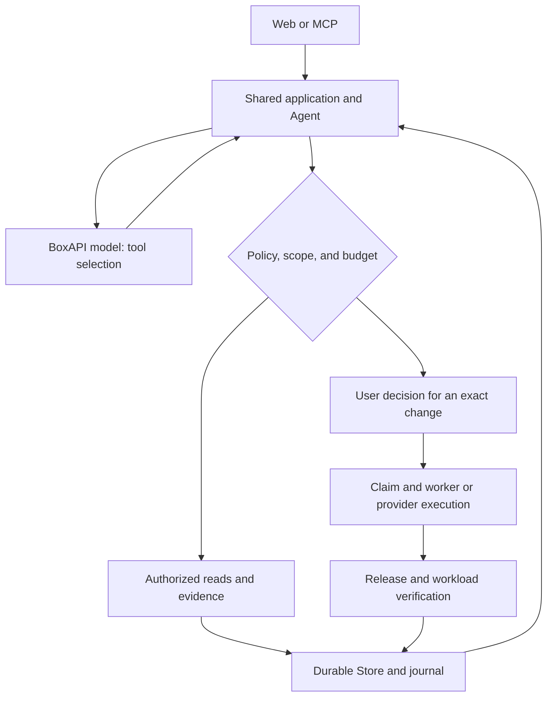

English · [فارسی](README.md)


# Launchlane

An agent-driven assistant for preparing, deploying, and checking projects on
**Liara**. Introduce a project; Launchlane inspects its source, proposes the work
needed, and asks for your decision before infrastructure changes. Execution results
are tied to the exact artifact, release, and collected evidence.

**Under active development:** bounded paths have real validation, but complete
deployment of every architecture and all 14 platform families is still in progress.
The [platform matrix](docs/platform-support.md) and [verification index](docs/verification.md)
distinguish implemented paths, local tests, and actual provider evidence. The current
application interface is in Persian.


Actual UI in a disposable test session. Selecting a project starts the workflow;
opening a page alone does not start a model call or deployment. This image is not
evidence of a cloud release.

## What it does

- **Understand the project:** import a folder, GitHub source, or upload; inspect
  within bounds without running source; preserve a private immutable source archive.
- **Prepare and repair:** let the Agent select tools, build or repair in a bounded
  worker, run checks, and retain a derived artifact while preserving the original source.
- **Review changes before deployment:** inspect the destination, resources, reported
  costs, and proposed changes. Server-side approval binds the exact account, app,
  arguments, and artifact.
- **Observe and recover:** check the release, page/API response, and same-origin assets;
  investigate a site problem and restore a previous artifact on supported paths.
- **Handle configuration and data:** encrypted environment inputs, private resource
  binding, disposable PostgreSQL tests, and independent destination data reads in
  the existing bounded integration. These do not establish production migrations or
  persistence after a restart.

## Quickstart

For a private local installation, use **Node.js 24.15+ within 24.x**, npm, and Git.
The current validated local environment is Windows/PowerShell with Node 24.18.0.
Offline startup needs no Liara key, model key, or Docker. Isolated worker execution
requires a Linux Docker engine and the prescribed images.

From your preferred parent directory:

```sh
git clone https://github.com/Pezhm4n/launchlane.git
cd launchlane
npm ci
npm run setup:local
npm run dev
```

Open <http://127.0.0.1:3000>. Read the login key **locally only** from
`.local/operator-access.txt`. Setup generates separate login/session secrets,
preserves existing configuration, and contacts no provider. `.env.local`, `.local/`,
and `.data/` are private and must not be published.

After signing in, use **انتشار پروژه** (Publish project), choose a folder or
**امتحان با پروژه نمونه** (Try a sample project), and inspect the files. Chat is
optional. The second tab, **بررسی مشکل سایت** (Investigate a site problem), provides
a separate evidence and symptom investigation flow. Disabled or incomplete
capabilities show their reason.

Stop the server with `Ctrl+C`. Local data remains; do not delete it to resolve an
error. After configuration or migration changes, restart the process when no
operation is in progress. See [setup](docs/setup.md) for ports, production startup,
and common problems.

## Connect services

All real-execution gates default to off. Model requests cost money; cloud APIs and
workers have additional prerequisites and authorized scope. A gate never replaces
approval of an individual action.

| Need | Main configuration | Default |
| --- | --- | --- |
| BoxAPI model | `MODEL_API_KEY`, `MODEL_ID`, `LAUNCHLANE_ENABLE_LIVE_MODEL` | Empty key/model, gate off |
| Liara reads | Connect through **حساب‌ها** (Accounts), `LAUNCHLANE_ENABLE_LIVE_LIARA` | Off |
| Infrastructure changes | `LAUNCHLANE_ENABLE_MUTATIONS` and valid action approval | Off |
| Code repair | `LAUNCHLANE_ENABLE_LOCAL_REPAIR` and a ready worker | Off |
| PostgreSQL data reads | `LAUNCHLANE_ENABLE_DATABASE_DATA_READS` and private-route allowlist | Off, empty list |

Use [.env.example](.env.example) and [setup](docs/setup.md); historical model IDs or
prices are not current defaults. Read [hosted access](docs/hosted-access.md) before
exposing an HTTPS installation. Web and [MCP](docs/mcp.md) share policy, tools, and state.

## How it works

The model proposes tools and next actions. The host enforces input validation,
scope, budgets, and authority. Source, logs, and tool responses cannot grant permission.



A release, an HTTP response, and data correctness are separate evidence. The
[independent data-check card](docs/assets/readme/database-observation.png) shows
the actual UI with test responses; its result does not establish production
migrations, application writes, or persistence.

## Development and contributing

```sh
npm run lint
npm run typecheck
npm run test:domain
npm run build -- --webpack
npx playwright install chromium
npm run test:http
```

HTTP tests start their own temporary server and need Chromium and OpenSSL for the HTTPS/MCP flow. On Linux, run `npx playwright install --with-deps chromium` first. Browser and Docker checks have separate
prerequisites; `npm test` is only a smoke check and requires a running server.
Continue with [contributing](CONTRIBUTING.md), the [documentation index](docs/README.md),
[architecture](ARCHITECTURE.md), and [acceptance criteria](docs/acceptance.md).
After publication, use Issues for sanitized bug reports and feature requests.
See [SECURITY.md](SECURITY.md) for sensitive reports.

## License

Original code and documentation use the [MIT License](LICENSE). Fonts, Liara branding,
and reference material have separate terms; see [third-party notices](THIRD_PARTY_NOTICES.md).
The owner has confirmed redistribution permission for IRANYekan, but the supporting
license file still needs to be added. Launchlane is an independent project and does
not claim official affiliation with Liara.
