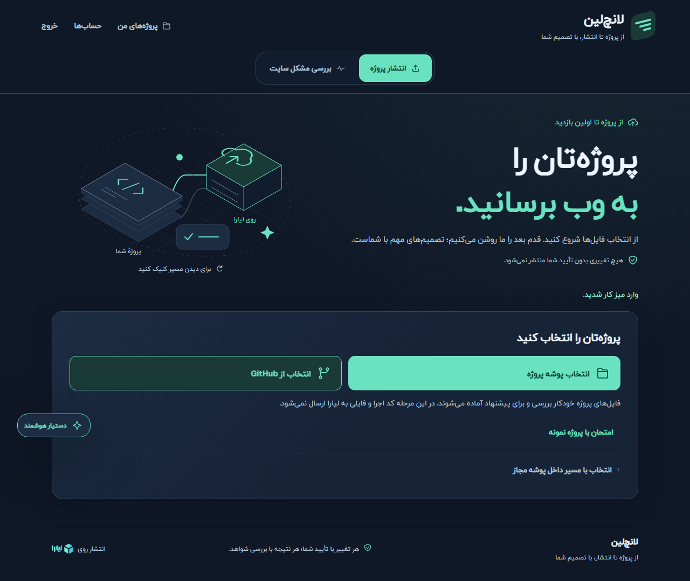
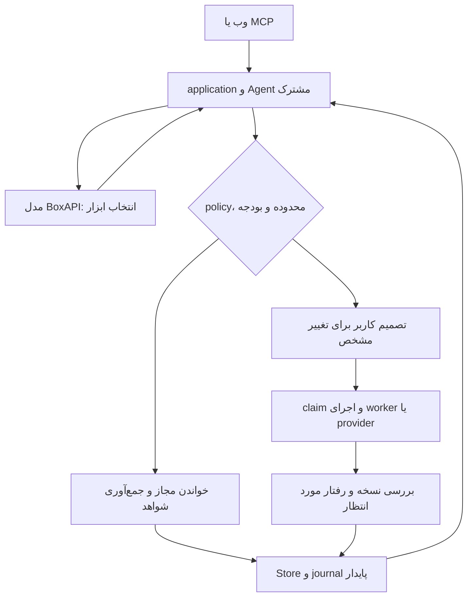

<div dir="rtl" lang="fa">

فارسی · [English](README.en.md)


# Launchlane

دستیار عامل‌محور برای آماده‌سازی، انتشار و بررسی پروژه روی **لیارا**. پروژه را معرفی کنید؛ Launchlane سورس را بررسی می‌کند، برای اقدام‌های لازم پیشنهاد می‌سازد و پیش از تغییر زیرساخت، تصمیم شما را می‌گیرد. پس از اجرا، نتیجه را به نسخه و شواهد همان انتشار متصل می‌کند.

**در حال توسعه:** مسیرهای واقعی و آزموده‌شده‌ای دارد، اما هنوز انتشار کامل همهٔ معماری‌ها و تمام ۱۴ خانوادهٔ پلتفرم را پوشش نمی‌دهد. وضعیت هر مسیر و تفاوت آزمون محلی با اجرای واقعی در [ماتریس پلتفرم‌ها](docs/platform-support.md) و [شواهد اعتبارسنجی](docs/verification.md) مشخص است. رابط فعلی فارسی است.



رابط واقعی در نشست آزمایشی جداگانه؛ انتخاب پروژه شروع مسیر است و بازکردن صفحه به‌خودی‌خود مدل یا انتشار را اجرا نمی‌کند. این تصویر شاهد انتشار ابری نیست.

## چه کاری انجام می‌دهد؟

- **شناخت پروژه:** ورود از پوشه، GitHub یا بارگذاری؛ بررسی محدود و بدون اجرای سورس؛ نگهداری نسخهٔ خصوصی و تغییرناپذیر از فایل‌های مجاز.
- **آماده‌سازی و اصلاح:** انتخاب ابزار توسط Agent، ساخت یا اصلاح در worker محدود، آزمون و نگهداری artifact مشتق، با حفظ سورس اصلی.
- **انتشار با تصمیم روشن:** مقصد، منابع، هزینهٔ گزارش‌شده و تغییرها قابل بازبینی‌اند؛ تأیید سروری به حساب، برنامه، ورودی‌ها و artifact دقیق متصل است.
- **بررسی و بازیابی:** مشاهدهٔ release، پاسخ صفحه/API و assetهای همان origin؛ بررسی مشکل سایت و بازیابی artifact قبلی در مسیرهای پشتیبانی‌شده.
- **تنظیمات و داده:** متغیرهای رمز‌شده، اتصال خصوصی منابع و آزمون موقت PostgreSQL؛ خواندن مستقل دادهٔ مقصد در integration محدود موجود. این قابلیت، اجرای migration تولیدی یا ماندگاری پس از restart را اثبات نمی‌کند.

## راه‌اندازی سریع

برای نصب خصوصی محلی، **Node.js نسخهٔ 24.15 به بالا از شاخهٔ 24.x**، npm و Git لازم است. محیط فعلی آزموده‌شده Windows/PowerShell با Node 24.18.0 است. برای شروع آفلاین به کلید لیارا، کلید مدل یا Docker نیاز ندارید؛ اجرای worker ایزوله به Docker Linux و imageهای تعیین‌شده نیاز دارد.

در پوشهٔ دلخواه اجرا کنید:

<div dir="ltr">

```sh
git clone https://github.com/Pezhm4n/launchlane.git
cd launchlane
npm ci
npm run setup:local
npm run dev
```

</div>

نشانی <http://127.0.0.1:3000> را باز کنید. کلید ورود را **فقط محلی** از `.local/operator-access.txt` بردارید. setup کلیدهای مستقل ورود و نشست را می‌سازد، تنظیمات موجود را حفظ می‌کند و با provider تماس نمی‌گیرد. فایل‌های `.env.local`، `.local/` و `.data/` خصوصی‌اند و نباید منتشر شوند.

پس از ورود، در «انتشار پروژه» یک پوشه انتخاب کنید یا «امتحان با پروژه نمونه» را بزنید و بررسی فایل‌ها را ببینید. چت اختیاری است. تب دوم، «بررسی مشکل سایت»، مسیر مستقلی برای جمع‌آوری شواهد و بررسی همان نشانه دارد. قابلیت خاموش یا ناقص با دلیل نمایش داده می‌شود.

توقف سرور با `Ctrl+C` است. داده‌های محلی باقی می‌مانند؛ آن‌ها را برای رفع خطا حذف نکنید. پس از تغییر تنظیمات یا migration، در زمان نبود عملیات جاری فرایند را دوباره اجرا کنید. جزئیات پورت، production و خطاهای رایج در [راهنمای نصب](docs/setup.md) آمده است.

## اتصال سرویس‌ها

همهٔ gateهای اجرای واقعی به‌صورت پیش‌فرض خاموش‌اند. اجرای مدل هزینه دارد؛ APIهای ابری و workerها پیش‌نیاز و محدودهٔ مجاز خود را دارند. gate جای تأیید هر اقدام را نمی‌گیرد.

| نیاز | تنظیم اصلی | پیش‌فرض |
| --- | --- | --- |
| مدل BoxAPI | `MODEL_API_KEY`، `MODEL_ID`، `LAUNCHLANE_ENABLE_LIVE_MODEL` | کلید/مدل خالی، gate خاموش |
| خواندن لیارا | اتصال از «حساب‌ها»، `LAUNCHLANE_ENABLE_LIVE_LIARA` | خاموش |
| تغییر زیرساخت | `LAUNCHLANE_ENABLE_MUTATIONS` و تصمیم معتبر همان اقدام | خاموش |
| اصلاح کد | `LAUNCHLANE_ENABLE_LOCAL_REPAIR` و worker آماده | خاموش |
| خواندن دادهٔ PostgreSQL | `LAUNCHLANE_ENABLE_DATABASE_DATA_READS` و allowlist مسیر خصوصی | خاموش، فهرست خالی |

از [.env.example](.env.example) و [راهنمای نصب](docs/setup.md) استفاده کنید؛ مدل یا قیمت تاریخی را پیش‌فرض امروز فرض نکنید. برای نصب عمومی HTTPS، ابتدا [طرح دسترسی میزبانی](docs/hosted-access.md) را بخوانید. وب و [MCP](docs/mcp.md) همان policy، ابزار و state را استفاده می‌کنند.

## سازوکار

مدل ابزار و اقدام بعدی را پیشنهاد می‌کند؛ میزبان اعتبار ورودی، محدوده، بودجه و مجوز را کنترل می‌کند. source، log و پاسخ ابزار اختیار ایجاد نمی‌کنند.

<div dir="ltr">



</div>

انتشار، پاسخ HTTP و صحت داده شواهد جدا دارند. [نمونهٔ کارت بررسی مستقل داده](docs/assets/readme/database-observation.png) از رابط واقعی با پاسخ‌های آزمایشی ثبت شده است؛ نتیجهٔ آن، migration، نوشتن برنامه یا ماندگاری تولیدی را تأیید نمی‌کند.

## توسعه و مشارکت

<div dir="ltr">

```sh
npm run lint
npm run typecheck
npm run test:domain
npm run build -- --webpack
npx playwright install chromium
npm run test:http
```

</div>

آزمون HTTP سرور موقت خود را می‌سازد و برای مسیر HTTPS/MCP به Chromium و OpenSSL نیاز دارد؛ روی Linux پیش از آن `npx playwright install --with-deps chromium` را اجرا کنید. آزمون‌های مرورگر و Docker پیش‌نیاز جدا دارند؛ `npm test` فقط smoke و نیازمند سرور در حال اجراست. [راهنمای مشارکت](CONTRIBUTING.md)، [فهرست مستندات](docs/README.md)، [معماری](ARCHITECTURE.md) و [معیارهای پذیرش](docs/acceptance.md) مسیر بعدی‌اند. اشکال و پیشنهاد را پس از انتشار مخزن در Issues با شواهد بدون اطلاعات خصوصی ثبت کنید؛ برای موارد حساس [SECURITY.md](SECURITY.md) را ببینید.

## مجوز

کد و مستندات تألیفی با [MIT](LICENSE) منتشر می‌شوند. فونت‌ها، نشان لیارا و منابع مرجع شرایط جدا دارند؛ [یادداشت دارایی‌های ثالث](THIRD_PARTY_NOTICES.md) را بخوانید. مجوز بازتوزیع IRANYekan توسط مالک تأیید شده، اما فایل مدرک آن هنوز باید به مخزن افزوده شود. Launchlane پروژه‌ای مستقل است و وابستگی رسمی به لیارا ادعا نمی‌کند.

</div>
