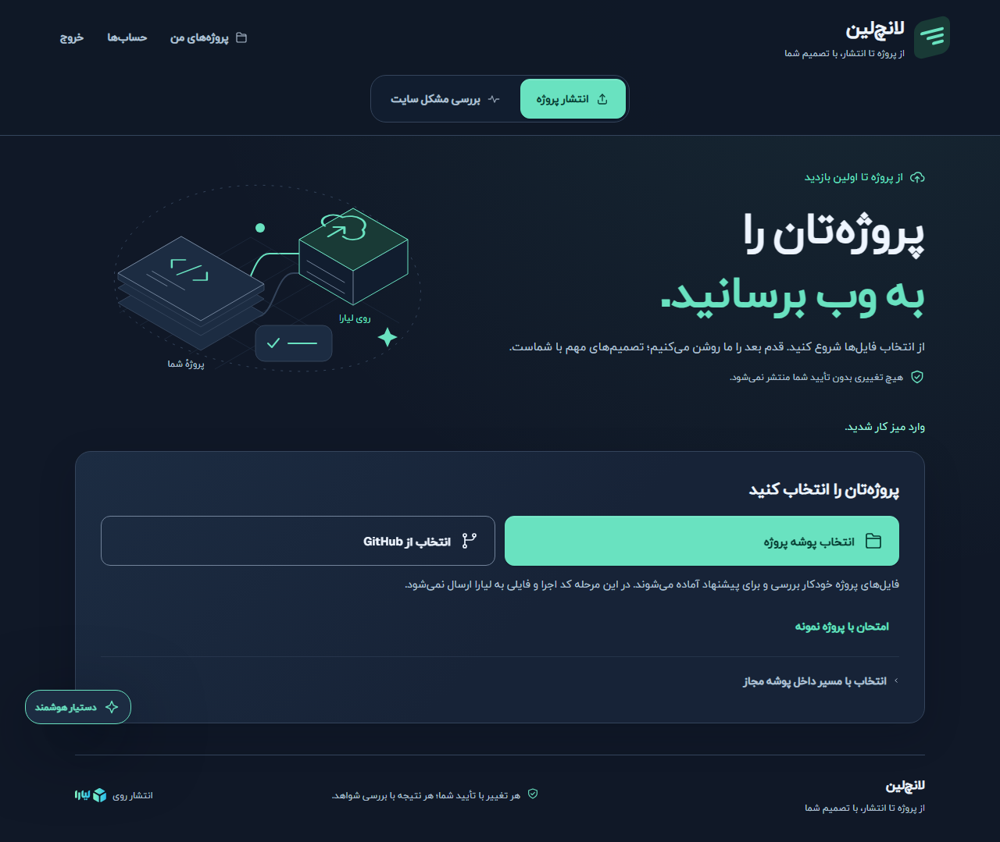
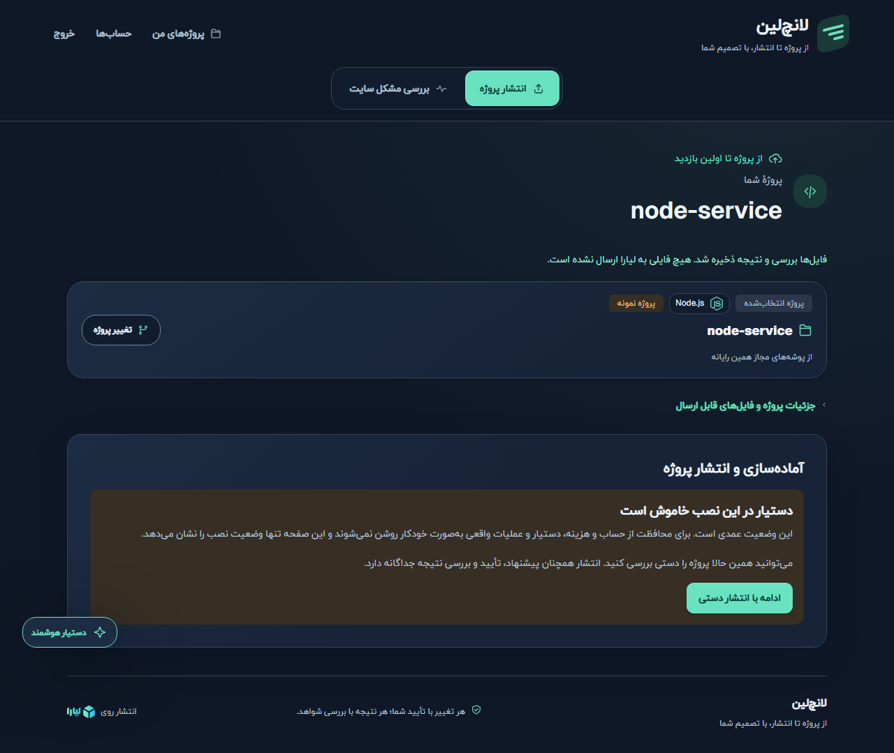
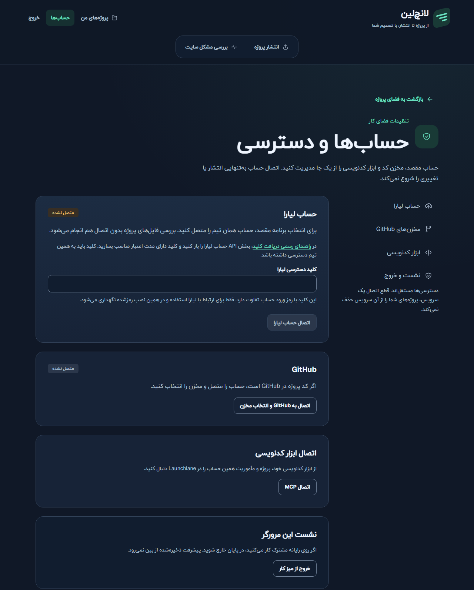
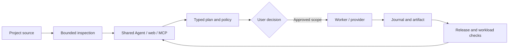

<div dir="rtl" lang="fa">

[English](README.en.md) · [راهنمای نصب](docs/setup.md) · [پشتیبانی پلتفرم‌ها](docs/platform-support.md)


# Launchlane

**از سورس پروژه تا انتشار روی لیارا، با تصمیم شما و نتیجهٔ قابل بررسی.**

لانچ‌لین یک میز کار تحت وب برای شناخت پروژه، آماده‌سازی و اصلاح محدود، انتشار و بررسی مشکل سایت است. پروژه را از رایانه یا GitHub معرفی می‌کنید؛ عامل از ابزارهای واقعی برنامه استفاده می‌کند، تغییر لازم را برای بررسی نشان می‌دهد و نتیجه را به همان artifact و انتشار متصل می‌کند. رابط کاربری فارسی است و چت، کنار مسیر اصلی انتشار، اختیاری می‌ماند.

[](package.json)
[](LICENSE)



نمای واقعی رابط در یک نشست محلی جدا با دادهٔ آزمایشی؛ تصاویر، شاهد انتشار ابری نیستند. [جزئیات و بازتولید تصاویر](docs/assets/readme/README.md).

**در حال توسعه:** مسیرهای اجرایی برای خانواده‌های هدف وجود دارند، اما انتشار کامل هر پروژه و پذیرش تولیدی تمام ۱۴ خانواده هنوز کامل نیست. ساخت موفق، release آماده، پاسخ HTTP و صحت داده معیارهای جدا هستند. [جدول دقیق قابلیت‌ها و محدودیت‌ها](docs/platform-support.md) و [شواهد نسخه‌های آزموده‌شده](docs/verification.md) را ببینید.

## اولین نتیجه، بدون کلید سرویس

برای **نصب تازهٔ خصوصی**، Git، npm و **Node.js نسخهٔ 24.15 یا بالاتر در شاخهٔ 24.x** لازم است. میزبان محلی آزموده‌شده Windows/PowerShell با Node 24.18.0 است. فرمان‌های زیر در PowerShell و shellهای POSIX یکسان‌اند؛ دریافت وابستگی‌ها به اینترنت نیاز دارد. برای این مسیر، Docker، حساب لیارا و کلید مدل لازم نیست.

<div dir="ltr">

```sh
git clone https://github.com/Pezhm4n/launchlane.git
cd launchlane
npm ci
npm run setup:local
npm run dev
```

</div>

1. نشانی <http://127.0.0.1:3000> را باز کنید.
2. در نصب تازهٔ محلی، کلید ورود را از فایل خصوصی `.local/operator-access.txt` روی همان رایانه بردارید. این کلید با رمز لیارا تفاوت دارد.
3. در «انتشار پروژه»، **«امتحان با پروژه نمونه»** را بزنید. نام `node-service` و نتیجهٔ بررسی فایل‌ها را می‌بینید؛ چیزی روی لیارا ارسال نمی‌شود.
4. برای پروژهٔ خودتان، «انتخاب پوشه پروژه» را بزنید. شناسایی سورس به‌خودی‌خود اسکریپت‌های آن را اجرا نمی‌کند.

<details>
<summary>نمای نتیجهٔ بررسی نمونه</summary>



</details>

سرور با `Ctrl+C` متوقف می‌شود و داده‌های محلی باقی می‌مانند. `.env.local`، `.local/`، `.data/` و archiveهای خصوصی را حفظ کنید و در Git نگذارید. `setup:local` تنظیمات و کلیدهای موجود را نگه می‌دارد؛ در نصب قبلی با `LAUNCHLANE_AUTH_MODE=liara`، ورود همچنان با حساب لیاراست. [تفاوت روش‌های ورود و رفع خطاهای میزبان](docs/setup.md).

## وقتی آمادهٔ اجرای واقعی هستید

از صفحهٔ **«حساب‌ها و دسترسی»**، لیارا، GitHub و اتصال ابزار کدنویسی را مدیریت کنید. اتصال حساب به‌تنهایی انتشار یا مصرف مدل را شروع نمی‌کند.

<details>
<summary>نمای صفحهٔ حساب‌ها و دسترسی</summary>



</details>

- **آماده‌سازی پروژه:** root، runtime، manager و lockfile بررسی می‌شوند. مسیرهای پشتیبانی‌شده، فرمان‌های اصلی install/build/test/start را در worker محدود اجرا می‌کنند؛ componentهای pnpm با ساختار workspace و خروجی آزموده‌شدهٔ خودشان نگه داشته می‌شوند.
- **مقصد و منابع:** مقصد، شبکه، تنظیمات امن و منابع داده از مسیر مشترک پیشنهاد و تصمیم عبور می‌کنند. دادهٔ آزمایشی PostgreSQL، اجرای runner و خواندن دادهٔ مقصد، اختیار migration تولیدی ایجاد نمی‌کنند.
- **انتشار و نگهداری:** انتشار artifact انتخابی، مشاهدهٔ release و پاسخ مورد انتظار، بررسی مشکل، بازگردانی artifact و کنترل‌های روشن‌کردن/توقف/حذف در محدودهٔ پشتیبانی‌شده موجودند. عملیات مبهم، اجازهٔ retry کور نمی‌گیرد.

در نصب تازه، gateهای مدل، خواندن لیارا، تغییر زیرساخت، اصلاح و خواندن داده خاموش‌اند. **درخواست مدل هزینه دارد**؛ پیش از فعال‌سازی، مدل مجاز، بودجه و محدودیت نصب را تعیین کنید. workerها به Docker Linux و image/ابزار دقیق همان مسیر نیاز دارند. کلیدها را در فرم امن یا تنظیمات سرور قرار دهید، هرگز در چت و `NEXT_PUBLIC_` نگذارید. [.env.example](.env.example) و [راهنمای تنظیم سرویس‌ها](docs/setup.md) مسیر اجرایی را توضیح می‌دهند.

وب و [MCP](docs/mcp.md) از همان registry، policy و Store استفاده می‌کنند. برای انتشار عمومی خود لانچ‌لین، [راهنمای HTTPS و هویت مستقل کاربران](docs/hosted-access.md) را بخوانید؛ نصب محلی به‌تنهایی طرح میزبانی عمومی نیست.

## یک تغییر چگونه اجرا می‌شود؟

مدل پیشنهاد می‌دهد؛ سرور، ورودی‌ها، محدوده، بودجه و تصمیم معتبر را کنترل می‌کند. تأیید به actor، مقصد، هزینه، ورودی و artifact مشخص بسته است. این نمودار مسیر یک تغییر تأییدشده را نشان می‌دهد؛ جزئیات [معماری](ARCHITECTURE.md) جداست.

<div dir="ltr">



</div>

## توسعه و مستندات

از ریشهٔ مخزن، بررسی‌های مرتبط با تغییر را اجرا کنید:

<div dir="ltr">

```sh
npm run lint
npm run docs:check
npm run typecheck
npm run test:domain
npm run build
npx playwright install chromium
npm run test:http
```

</div>

تست HTTP سرور موقت خود را می‌سازد؛ مسیر HTTPS/MCP به Chromium و OpenSSL نیاز دارد. روی Linux، پیش از آن `npx playwright install --with-deps chromium` را اجرا کنید. `npm test` فقط smoke و نیازمند سرور در حال اجراست. تست‌های مدل/لیارای مصنوعی، پذیرش واقعی provider نیستند؛ تست worker به پیش‌نیازهای [مسیر مربوط](docs/platform-support.md) نیاز دارد.

[فهرست مستندات](docs/README.md) · [مشارکت](CONTRIBUTING.md) · [معیارهای پذیرش](docs/acceptance.md) · [کارهای باز](TASKS.md) · [گزارش امنیتی](SECURITY.md)

## مجوز و اعتبارها

کد و مستندات تألیفی با [MIT](LICENSE) عرضه می‌شوند. فونت‌ها، نشان لیارا و منابع ثالث شرایط جدا دارند؛ [یادداشت دارایی‌های ثالث](THIRD_PARTY_NOTICES.md) را بخوانید. مالک مجوز بازتوزیع IRANYekan را تأیید کرده، اما مدرک قابل درج آن هنوز باید افزوده شود. نشان موجود لانچ‌لین حفظ شده و تصاویر از خود برنامه ثبت شده‌اند. این پروژه وابستگی رسمی به لیارا ادعا نمی‌کند.

</div>
